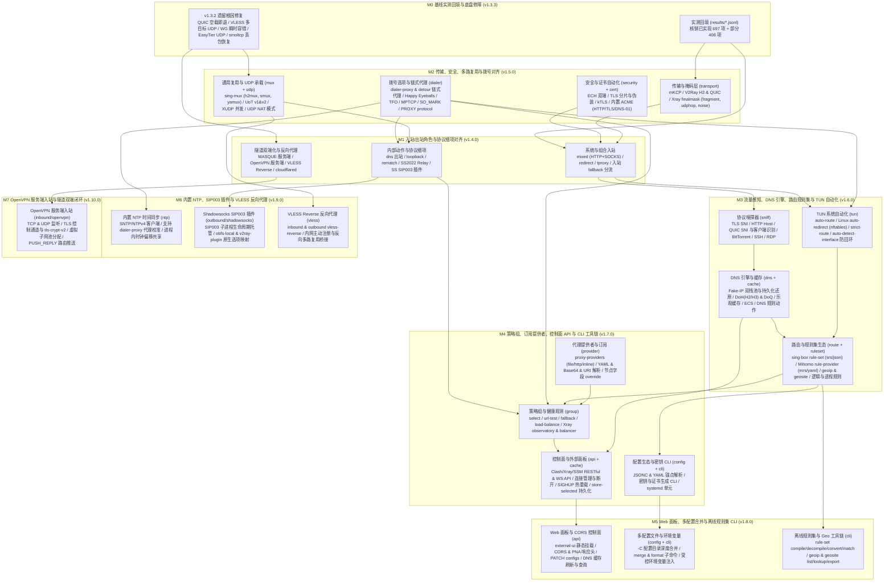

# 项目状态

更新日期：2026-11-07（Asia/Shanghai）

## 版本

最新发布：[v1.14.0](docs/releases/1.14.0.md)（[GitHub Release v1.14.0](https://github.com/yuuuki-creation/kerlico/releases/tag/v1.14.0)），带 Linux `x86_64` 二进制。`M12`–`M13` 完成统一 DNS 管线与 IP 规则解析、运行时真实 Geo 数据与 `.srs`/`.mrs` 二进制规则集、Linux TUN 自动路由与防回环、全协议 `DialerOptions` 拨号工厂、`sing-mux` 线格式互通、uTLS ClientHello 指纹与完整套件通告、Hysteria2 Brutal 与伪装反向代理、控制面 WebSocket 推送与 `PATCH /configs`，并通过 Mihomo v1.19.33 同配置 14 场景与 600 秒混合流量长稳（34,632 请求 0 失败）对照验收（见 [Mihomo 替换验收](docs/testing/mihomo-replacement-acceptance-2026-11-07.md)）。

构建基线：Rust `1.99.1`，Linux `x86_64`。

## 完成计划与后续排期

| 版本 / 阶段 | 交付 | 状态 |
| --- | --- | --- |
| `v1.0.1` | 门禁通过；第三方许可通知；Linux 二进制 | 已发布 |
| `v1.1.0` | CLI 接入 WARP；规则路由；DNS 与错误事件历史；中英使用指南 | 已发布 |
| `v1.2.0` | `dns`、`tun`、`control` 模块 | 已发布 |
| `v1.3.0` | MASQUE、OpenVPN、OpenConnect、Tailscale、ZeroTier、EasyTier；VLESS XUDP 迁移 | 已发布 |
| `v1.3.1` | 复查修复：UDP 包让节点停止、Tailscale 直连握手、ZeroTier 入网、`require_remote_eof` | 已发布 |
| `v1.3.2` | 实机测试修复：Shadowsocks、SS2022、Sudoku 丢数据，Mieru 断流，WireGuard 丢包死锁，TrustTunnel H3 | 已发布 |
| `M0`（`v1.3.3`） | 能力总表 1,180 项已实现/部分实现实测回填；QUIC 空载关闭、VLESS 出站多目标 UDP、WireGuard 瞬时容错、EasyTier UDP、smoltcp 丢包恢复修复 | 已完成 |
| `M1`（`v1.4.0`） | 入站与出站角色及协议细项对齐：`mixed`、`redirect`、`tproxy` 入站，Trojan/VLESS 入站 `fallback` 分流（含 `xver` PROXY protocol），MASQUE 服务端入站，`dns` 内部出站，顶层 `mixed-port`/`redir-port`/`tproxy-port`/`lan-allowed-ips`/`lan-disallowed-ips`，Hysteria v1/v2 端口跳跃与速率/伪装，OpenVPN `servers`/`mss-fix`/`tls-crypt-v2`，OpenConnect mTLS，WireGuard `reserved`，ZeroTier TCP 回退及 HTTP/MASQUE/Naive/Mieru/Tailscale/EasyTier 出站扩展 | 已完成 |
| `M2`（`v1.5.0`） | 传输、安全、复用与拨号对齐：`dialer-proxy`/`detour` 链式拨号，入站 `accept_proxy_protocol`（PROXY v1/v2），`sing-mux`（`h2mux`/`smux`/`yamux`），Shadowsocks `UoT` v1/v2，XHTTP 完整分帧/混淆/`xmux` 与 Xray `finalmask`（`fragment`/`udp_hop`/`brutal`），TLS 证书/公钥 SHA-256 固定、ECH、热重载、ACME 自动证书与 REALITY `mldsa65_seed` | 已完成 |
| `M3`（`v1.6.0`） | 流量感知、DNS、路由规则集与 TUN 自动化对齐：TLS/HTTP/QUIC/BT 协议嗅探，Fake-IP 双栈池与持久化还原，DoH/DoQ、乐观缓存、ECS 与 DNS 规则动作，`rule-set`（`srs`/`mrs`/`dat`）与逻辑/进程规则，TUN `auto-route`/`auto-redirect` | 已完成 |
| `M4`（`v1.7.0`） | 策略组、订阅提供者、控制面 API 与 CLI 工具链对齐：`select`/`url-test`/`fallback`/`load-balance`/`balancer` 策略组，`proxy-providers` 订阅解析与字段覆写，Clash/Xray/SSM RESTful & WS 控制面 API，YAML/JSONC 配置解析与密钥/证书生成 CLI，`SIGHUP` 热重载与 systemd 服务单元 | 已完成 |
| `M5`（`v1.8.0`） | Web 面板与跨域支持、多配置合并与离线规则集 CLI：`external-ui`/`/ui` 静态面板托管与 CORS/PNA 响应头，`-C` 多配置文件深度合并与受控环境变量注入，`rule-set compile/decompile/convert/match` 与 `geoip`/`geosite` 离线 CLI 工具链（151 项） | 已完成 |
| `M6`（`v1.9.0`） | 内置 NTP、Shadowsocks SIP003 插件与 VLESS 反向代理：内置 SNTP/NTPv4 时钟偏移校准客户端（支持代理拨号），Shadowsocks SIP003 子进程托管与 `obfs-local`/`v2ray-plugin` 原生兼容，VLESS Reverse 内网穿透反向代理（67 项） | 已完成 |
| `M7`（`v1.10.0`） | OpenVPN 服务端入站与隧道双端闭环：`inbound/openvpn` TCP/UDP 服务端入站、TLS 控制通道与 `tls-auth`/`tls-crypt`/`tls-crypt-v2`、子网地址池分配、`PUSH_REPLY` 路由下发与多客户端会话管理（82 项） | 已完成 |
| `M8`（`v1.11.0`） | Mihomo YAML 原生直通与全协议订阅解析：顶层 `port`/`socks-port`/`allow-lan`/`bind-address`/`mode`/`rules`/`sub-rules`、内置 `DIRECT`/`REJECT`/`PASS` 自动注入、`proxy-providers` 字段 `override` 及 `vmess`/`ss`/`ssr`/`vless`/`trojan`/`hy2`/`tuic`/`anytls`/`wg` URI 分享链接解析 | 已完成 |
| `M9`（`v1.11.0`） | TUN 自动路由守卫、UDP/TCP DNS 劫持与本机进程匹配：`TunRouteGuard` 生命周期路由安装回滚与 `route-address-set` 展开、多目标 UDP 与 TCP DNS 劫持自动注入、跨平台本机套接字进程解析与 `PROCESS-NAME*`/`PROCESS-PATH*` 规则匹配 | 已完成 |
| `M10`（`v1.11.0`） | Hysteria2 / TUIC 动态 UDP 端口跳跃与 `SUB-RULE`：TUIC `HoppingSocket`（`ports`/`mport`/`hop_interval`/`hop_interval_max`）、Hysteria2 毫秒级跳跃间隔与 `mport`、`RouteTable` 命名子规则表递归求值 | 已完成 |
| `v1.12.0` | 17 协议 70 组合性能对标与数据面全栈加速：公网 1Gbps 跨机 30s 与内网环回 256MiB 双场景 70/70 达标（`>= 78%` Mihomo），8 流总吞吐分别达 Mihomo 的 109.1% 与 103.2%，双端峰值内存占 Mihomo 中位数约 55.1% | 已发布 |
| `M11`（`v1.13.0`） | 真实化：审计 2,080 项已实现标注；修复 OpenVPN 服务端默认账号与证书校验、路由条件全匹配、SIP003 静默降级；测速与健康检查、热重载、远程资源下载、连接表、OpenVPN 服务端、Mihomo 字段映射、密钥生成与 `cache.db` 改为真实实现；能力总表按审计回写 | 已发布 |
| `M12`–`M13`（`v1.14.0`） | Mihomo 替换就绪与真实化收口：统一 DNS 管线与 IP 规则解析、运行时真实 Geo 与 `.srs`/`.mrs` 规则集、Linux TUN 自动路由与防回环、全协议 `DialerOptions` 套接字工厂、`sing-mux` 线格式互通、uTLS ClientHello 指纹与完整套件通告、Hysteria2 Brutal 与伪装反代、全局入站嗅探与 TProxy UDP、控制面 WebSocket 与 `PATCH /configs`；Mihomo v1.19.33 同配置 14 场景与 600 秒长稳（34,632 请求 0 失败）对照验收通过 | 已发布 |
| `M14` 起 | 剩余服务端与外围子项：内置 ACME 协议签发、服务端 ECH 解密、VLESS Reverse 注册隧道、内置 NTP 后台校准循环等 | 待做 |

验证规则见 [0012](docs/decisions/0012-simplified-delivery-and-verification.md)。跨进程设备 daemon/IPC 不在计划内，出现多进程部署需求时再排。

## 三核心主要功能对齐拓扑

[能力总表](docs/capability-matrix/README.md) 汇总 Mihomo、sing-box、Xray 文档共 4,360 项：当前已实现 1,353 项、部分实现 530 项、未实现 2,148 项、不适用 329 项；实测通过 1,540 项，只计指向具名测试或互通用例的项。下图是 `M0`–`M7` 的架构模块拓扑，逐项状态以能力总表为准。

## 能力现状

| 能力 | 现状 |
| --- | --- |
| 协议模块 | 30 个进入默认构建。双端 22 个（含 MASQUE、OpenVPN）；仅入站：TUN、Mixed、Redirect、TProxy；仅出站：SSH、Gost Relay、Tor、OpenConnect、Tailscale、EasyTier、ZeroTier、DNS |
| 节点与出站 | 独立节点；单一 `EgressRuntime`/`Dispatcher`；`Local`/`Remote` 分支；`FamilyMode`；`select`/`url-test`/`fallback`/`load-balance` 策略组按后台实测延迟选择；http 订阅经出站下载，`override` 先于字段映射应用；全部出站与 DNS 上游统一经 `DialerOptions` 套接字工厂（覆盖 `detour`/`dialer-proxy`、`routing_mark`、`interface_name`、TFO、MPTCP、uTLS `client-fingerprint` 与 `skip-cert-verify`）；`sing-mux`（`smux`/`yamux`/`h2mux` + padding）与上游线格式互通（含 SS2022） |
| 路由与嗅探 | `routes` / `route` 按域名、正则、`rule-set`/`rule-providers`（真实二进制 `.srs` v1–v4 与 `.mrs` v1，远程经出站下载并运行中刷新）、真实 Geo（`geoip.dat`、`geosite.dat`、`country.mmdb`、`ASN.mmdb`）、CIDR、来源 IP/端口、网络、协议、进程（惰性反查）、节点、用户与逻辑规则选择出站或策略组，或执行 `sniff`/`resolve`/`hijack-dns`/`reject`；未标 `no-resolve` 的 IP/GeoIP/ASN 规则自动解析域名目标；全部入站共用调度器嗅探阶段（TLS/HTTP/多包 QUIC/BT/DTLS/STUN/SSH/RDP），支持 `geoip:`/`geosite:`/`rule-set:` 跳过名单 |
| DNS | 本地出网、劫持 DNS、`dns.listen`（UDP/TCP）与 `/dns/query` 共用统一管线：按 `hosts` → Fake-IP 双栈池（含 `fake-ip-filter`） → `nameserver-policy` → `nameserver` / `fallback`（含 `fallback-filter`）求值，支持 UDP、TCP、DoT、DoH、DoQ、乐观缓存、ECS 与 `default-nameserver` / `proxy-server-nameserver` |
| TUN 与透明代理 | Linux 系统接口与按 `sing-tun` 布局实现的 `auto-route`（IPv4/IPv6 专用路由表与策略规则）、`strict-route`、`auto-redirect`（nftables）、`auto-detect-interface` 与逐出站 `routing-mark` 防回环放行；TUN 读取独立任务与 256 KiB 每向 TCP 缓冲；TProxy 支持 IPv4/IPv6 TCP 与 UDP（`IP_RECVORIGDSTADDR`/`IPV6_RECVORIGDSTADDR`） |
| 控制 | HTTP 与 WebSocket 控制面：`/v1/*` 统计；Clash/Mihomo 兼容的策略切换、实测延迟、`/connections`、`/traffic`、`/logs`、`/memory` WebSocket 与 HTTP 流、`/rules`（含逐规则 `hitCount`/`hitAt`/`missCount`/`missAt`）、`/dns/query`、`/cache/dns/flush`、`PUT/PATCH /configs` 与 `/restart` 热重载、`rule`/`global`/`direct` 模式切换；metacubexd 面板验收通过 |
| 用户与统计 | 管理账户与原生凭据分离；唯一计量边界；SQLite 用量、带宽、访问记录、DNS 与错误事件；`history` 查询 |
| WARP | `device` 配置启用；数据面用已保存身份在双栈机器上验证过，CLI 在真实单栈机器上的自动补齐未实测 |
| 双语 | CLI 帮助、错误和诊断完成；使用指南中英齐全；接口文档为中文 |
| 第三方合规 | 发行附 `THIRD_PARTY_NOTICES.txt`；`third_party/zerotier-node` 为 MPL-2.0 |

## 最新门禁

`v1.14.0`（`perf-02`，提交 `0537733`）：fmt、严格 Clippy、全量单元与回环集成测试、`zerotier-node` 与 `xray-transport` uTLS 塑造测试、release 与许可通知全部通过；发行二进制在 `perf-02` 构建。Mihomo v1.19.33 同配置 14 场景与 600 秒长稳（34,632 请求 0 失败）在 `perf-01` 验证通过（见 [Mihomo 替换验收](docs/testing/mihomo-replacement-acceptance-2026-11-07.md)）。

## 实机测试

30 个协议都在 `perf-01`、`perf-02`、`perf-03` 上跨机跑过，也都对过第三方真实对端，记录见 [跨机矩阵](docs/testing/cross-host-2026-11-03.md)、[第三方互通](docs/testing/peer-interop-2026-11-03.md)、[17 协议 70 组合性能对标报告](docs/testing/benchmarks/mihomo-vs-kerlico-2026-11-04/REPORT.md) 与 [Mihomo 替换验收报告](docs/testing/mihomo-replacement-acceptance-2026-11-07.md)。公网 1Gbps 跨机 30s 固定时长（`perf-01 <-> perf-03`）与内网环回 256MiB（`perf-01`）17 协议 70 组合 100% 达标（`>= 78%` Mihomo 吞吐）。`v1.3.2` 二进制的双端矩阵（TCP 小包与 1 MiB、UDP）：通过 1597，失败 45，不适用 128；44 项失败是 1200 字节及以上的 UDP 大包，1 项是 WireGuard IPv6 的 TCP 1 MiB，都在 MTU 1300 的 Mesh 路径上。

官网 https://www.kerlico.com ，文档站 https://wiki.kerlico.com 。源码和部署参数在 `site/`。

## 已知问题

- **Sudoku mux 测试关闭超时**：机器高负载时 `real_mux_uses_one_carrier_for_concurrent_distinct_targets_and_fin` 偶发 `Shutdown { cleanup_timed_out: true }`，原因未定位。
- **SS2022 EIH UDP 测试**：整树门禁中无回包失败过 2 次，单独压测 1000 轮与整树 5 轮都未复现，原因未定位。测试现在带新包序号重发，并断言节点的 `Dropped` 与 `Failed` 为零，重发次数打印到标准错误。
- **MASQUE**：`perf-03` 到 `perf-01` 的转发路径 32 MiB 约 20 分钟后 `eof`，吞吐 0.01 MiB/s，原因未定位。Mesh MTU 1300 低于 QUIC 路径 MTU 下限 1350，属路径限制。
- **ZeroTier**：伪造流量持续时，首次主动联系我们的成员学习变慢；本节点发起的查询不受影响。

## 已知互通差异

- **ShadowQUIC v2**：与固定版本 Mihomo 不互通；与受控 Go 参照 24 配置通过。
- **ShadowsocksR**：固定版本 Mihomo 的 `random_head` 与 `tls1.2_ticket_*` 混淆客户端发出坏流。抓包里失败流都带重复密文片段或被破坏的 TLS 记录头，通过的流没有；Rust→Python 100/100。
- **Sudoku**：固定 Mihomo 的 UDP 路径把数据报截断到 16384 字节。Mihomo 与官方的 split 客户端在停服后 12 秒内不关闭活动流，Mihomo 重启后的首个请求可能 EOF，两者的双端对照相同。
- **TrustTunnel**：官方 endpoint v1.1.0 的 H3 回写丢弃 16000 字节及以上的数据报，官方客户端接它同样超时；H1、H2 通过。
- **Tor**：公网字面 IPv6 未测。
- **sing-box 1.14.4**：Snell 与 Hysteria1 入站丢弃域名目标的 UDP，HTTPUpgrade 入站拒绝带 `Sec-WebSocket-Key` 的请求，gRPC 没有 multi 模式。对照见 [互通记录](docs/testing/peer-interop-2026-11-03.md)。

## 资料导航

[使用指南](docs/usage.md) · [设计导航](docs/README.md) · [实现接口](docs/interfaces/README.md) · [能力总表](docs/capability-matrix/README.md) · [历史测试记录](docs/testing/) · [协议与组合总表](reference/reports/三核心%20协议%20组合支持.md) · [借鉴映射](reference/design-map.md) · [仓库约定](docs/repository-workflow.md) · [匿名规则](docs/anonymity.md)
