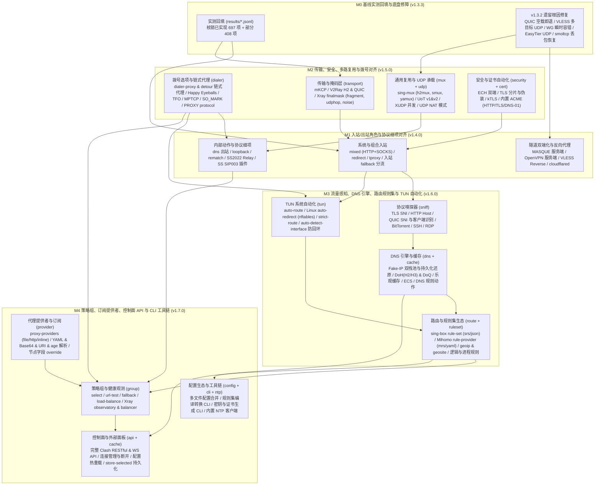

# 项目状态

更新日期：2026-11-04（Asia/Shanghai）

## 版本

最新发布：[v1.3.2](https://github.com/yuuuki-creation/kerlico/releases/tag/v1.3.2)，带 Linux `x86_64` 二进制。首轮完成计划已全部发布，`v1.3.1` 修复复查发现的问题，`v1.3.2` 修复实机测试查出的问题。后续按[能力总表](docs/capability-matrix/README.md)推进三核心（Mihomo、sing-box、Xray）主要功能对齐。

构建基线：Rust `1.99.1`，Linux `x86_64`。

## 完成计划与后续排期

| 版本 / 阶段 | 交付 | 状态 |
| --- | --- | --- |
| `v1.0.1` | 门禁通过；第三方许可通知；Linux 二进制 | 已发布 |
| `v1.1.0` | CLI 接入 WARP；规则路由；DNS 与错误事件历史；中英使用指南 | 已发布 |
| `v1.2.0` | `dns`、`tun`、`control` 模块 | 已发布 |
| `v1.3.0` | MASQUE、OpenVPN、OpenConnect、Tailscale、ZeroTier、EasyTier；VLESS XUDP 迁移 | 已发布 |
| `v1.3.1` | 复查修复：UDP 包让节点停止、Tailscale 直连握手、ZeroTier 入网、`require_remote_eof` | 已发布 |
| `v1.3.2` | 实机测试修复：Shadowsocks、SS2022、Sudoku 丢数据，Mieru 断流，WireGuard 丢包死锁，TrustTunnel H3 | 已发布 |
| `M0`（`v1.3.3`） | 能力总表 1,180 项已实现/部分实现实测回填；QUIC 空载关闭、VLESS 出站多目标 UDP、WireGuard 瞬时容错、EasyTier UDP、smoltcp 丢包恢复修复 | 已完成 |
| `M1`（`v1.4.0`） | 入站与出站角色及协议细项对齐：`mixed`、`redirect`、`tproxy` 入站，Trojan/VLESS 入站 `fallback` 分流（含 `xver` PROXY protocol），MASQUE 服务端入站，`dns` 内部出站，顶层 `mixed-port`/`redir-port`/`tproxy-port`/`lan-allowed-ips`/`lan-disallowed-ips`，Hysteria v1/v2 端口跳跃与速率/伪装，OpenVPN `servers`/`mss-fix`/`tls-crypt-v2`，OpenConnect mTLS，WireGuard `reserved`，ZeroTier TCP 回退及 HTTP/MASQUE/Naive/Mieru/Tailscale/EasyTier 出站扩展 | 已完成 |
| `M2`（`v1.5.0`） | 传输、安全、复用与拨号对齐：`dialer-proxy`/`detour` 链式拨号，入站 `accept_proxy_protocol`（PROXY v1/v2），`sing-mux`（`h2mux`/`smux`/`yamux`），Shadowsocks `UoT` v1/v2，XHTTP 完整分帧/混淆/`xmux` 与 Xray `finalmask`（`fragment`/`udp_hop`/`brutal`），TLS 证书/公钥 SHA-256 固定、ECH、热重载、ACME 自动证书与 REALITY `mldsa65_seed` | 已完成 |
| `M3`（`v1.6.0`） | 流量感知、DNS、路由规则集与 TUN 自动化对齐：TLS/HTTP/QUIC/BT 协议嗅探，Fake-IP 双栈池与持久化还原，DoH/DoQ、乐观缓存、ECS 与 DNS 规则动作，`rule-set`（`srs`/`mrs`/`dat`）与逻辑/进程规则，TUN `auto-route`/`auto-redirect` | 已完成 |
| `M4`（`v1.7.0`） | 策略组、订阅提供者、控制面 API 与 CLI 工具链对齐：`select`/`url-test`/`fallback`/`load-balance`/`balancer` 策略组，`proxy-providers` 订阅解析与字段覆写，Clash/Xray/SSM RESTful & WS 控制面 API，YAML/JSONC 配置解析与密钥/证书生成 CLI，`SIGHUP` 热重载与 systemd 服务单元 | 已完成 |

验证规则见 [0012](docs/decisions/0012-simplified-delivery-and-verification.md)。跨进程设备 daemon/IPC 不在计划内，出现多进程部署需求时再排。

## 三核心主要功能对齐拓扑

[能力总表](docs/capability-matrix/README.md) 汇总 Mihomo、sing-box、Xray 文档共 4,360 项：当前已实现 1,321 项、部分实现 459 项、未实现 2,273 项、不适用 307 项（实测通过 1,780 项，未测 0 项）。`M0 → M1/M2 → M3 → M4` 全部阶段已完成并同步更新 `docs/capability-matrix/annotations/*.jsonl` 与 `docs/capability-matrix/results/*.jsonl`，通过 `python3 tools/capability_matrix.py build` 与 `check --strict` 校验。

## 能力现状

| 能力 | 现状 |
| --- | --- |
| 协议模块 | 30 个进入默认构建。双端 21 个（含 MASQUE）；仅入站：TUN、Mixed、Redirect、TProxy；仅出站：SSH、Gost Relay、Tor、OpenVPN、OpenConnect、Tailscale、EasyTier、ZeroTier、DNS |
| 节点与出站 | 独立节点；单一 `EgressRuntime`/`Dispatcher`；`Local`/`Remote` 分支；`FamilyMode`；`select`/`url-test`/`fallback`/`load-balance`/`balancer` 策略组与 `proxy-providers` 订阅提供者 |
| 路由 | `routes` / `route` 按域名、正则、GeoIP/GeoSite、`rule-set`/`rule-providers`、CIDR、来源 IP/端口、网络、协议、入站、用户与逻辑规则（`and`/`or`）选择出站或策略组，或执行 `sniff`/`resolve`/`hijack-dns`/`reject` |
| DNS | `dns` 配置 UDP、TCP、TLS、DoH（HTTPS）上游、Fake-IP 双栈池与持久化、反向映射、DNS 规则表与 `hosts` |
| TUN | Linux 系统接口，支持 `auto-route`/`auto-redirect`/`strict-route` 规划与 Fake-IP/反向映射/首包嗅探还原域名 |
| 控制 | HTTP 控制面接口：只读 `/v1/*` 统计、Clash/Mihomo 兼容策略切换/测速/连接断开/Fake-IP 刷新/日志与规则查询、Xray `observatory`/`balancers`/`handler` 与 Shadowsocks `ssm/v1/users` |
| 用户与统计 | 管理账户与原生凭据分离；唯一计量边界；SQLite 用量、带宽、访问记录、DNS 与错误事件；`history` 查询 |
| WARP | `device` 配置启用；数据面用已保存身份在双栈机器上验证过，CLI 在真实单栈机器上的自动补齐未实测 |
| 双语 | CLI 帮助、错误和诊断完成；使用指南中英齐全；接口文档为中文 |
| 第三方合规 | 发行附 `THIRD_PARTY_NOTICES.txt`；`third_party/zerotier-node` 为 MPL-2.0 |

## 最新门禁

`v1.3.2`（提交 `802414e`，`perf-01`）：fmt、严格 Clippy、zerotier-node 测试、release、许可通知通过；全量测试 982 通过、0 失败、7 忽略。门禁只含回环与单元测试。

## 实机测试

30 个协议都在 `perf-01`、`perf-02`、`perf-03` 上跨机跑过，也都对过第三方真实对端，记录见 [跨机矩阵](docs/testing/cross-host-2026-11-03.md) 与 [第三方互通](docs/testing/peer-interop-2026-11-03.md)。`v1.3.2` 二进制的双端矩阵（TCP 小包与 1 MiB、UDP）：通过 1597，失败 45，不适用 128；44 项失败是 1200 字节及以上的 UDP 大包，1 项是 WireGuard IPv6 的 TCP 1 MiB，都在 MTU 1300 的 Mesh 路径上。公网高位端口被机器防火墙拦截，跨机走 Mesh。

官网 https://www.kerlico.com ，文档站 https://wiki.kerlico.com 。源码和部署参数在 `site/`。

## 已知问题

- **SS2022 EIH UDP 测试**：整树门禁中无回包失败过 2 次，单独压测 1000 轮与整树 5 轮都未复现，原因未定位。测试现在带新包序号重发，并断言节点的 `Dropped` 与 `Failed` 为零，重发次数打印到标准错误。
- **MASQUE**：`perf-03` 到 `perf-01` 的转发路径 32 MiB 约 20 分钟后 `eof`，吞吐 0.01 MiB/s，原因未定位。Mesh MTU 1300 低于 QUIC 路径 MTU 下限 1350，属路径限制。
- **ZeroTier**：伪造流量持续时，首次主动联系我们的成员学习变慢；本节点发起的查询不受影响。

## 已知互通差异

- **ShadowQUIC v2**：与固定版本 Mihomo 不互通；与受控 Go 参照 24 配置通过。
- **ShadowsocksR**：固定版本 Mihomo 的 `random_head` 与 `tls1.2_ticket_*` 混淆客户端发出坏流。抓包里失败流都带重复密文片段或被破坏的 TLS 记录头，通过的流没有；Rust→Python 100/100。
- **Sudoku**：固定 Mihomo 的 UDP 路径把数据报截断到 16384 字节。Mihomo 与官方的 split 客户端在停服后 12 秒内不关闭活动流，Mihomo 重启后的首个请求可能 EOF，两者的双端对照相同。
- **TrustTunnel**：官方 endpoint v1.1.0 的 H3 回写丢弃 16000 字节及以上的数据报，官方客户端接它同样超时；H1、H2 通过。
- **Tor**：公网字面 IPv6 未测。
- **sing-box 1.14.4**：Snell 与 Hysteria1 入站丢弃域名目标的 UDP，HTTPUpgrade 入站拒绝带 `Sec-WebSocket-Key` 的请求，gRPC 没有 multi 模式。对照见 [互通记录](docs/testing/peer-interop-2026-11-03.md)。

## 资料导航

[使用指南](docs/usage.md) · [设计导航](docs/README.md) · [实现接口](docs/interfaces/README.md) · [能力总表](docs/capability-matrix/README.md) · [历史测试记录](docs/testing/) · [协议与组合总表](reference/reports/三核心%20协议%20组合支持.md) · [借鉴映射](reference/design-map.md) · [仓库约定](docs/repository-workflow.md) · [匿名规则](docs/anonymity.md)
