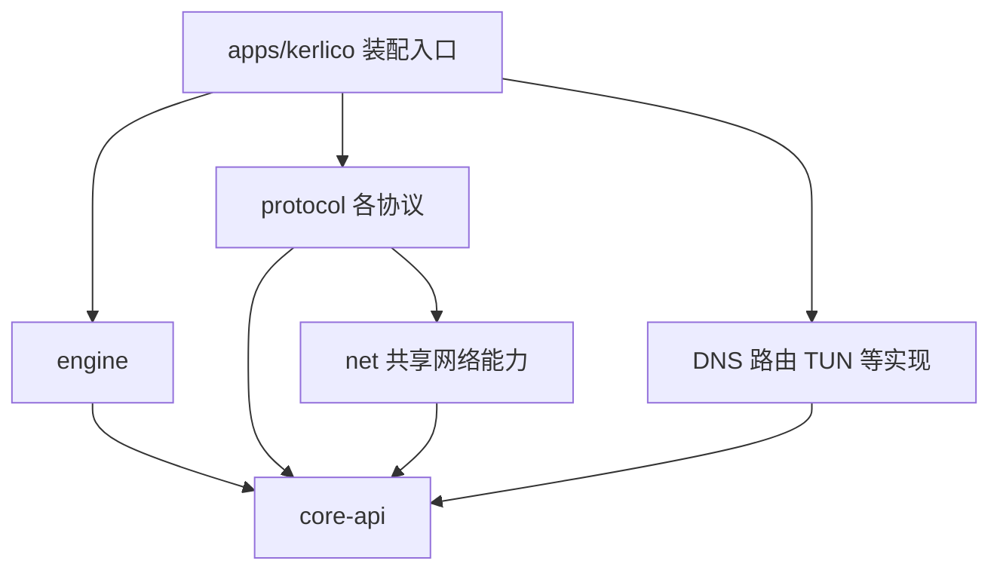

# 项目结构与单文件交付规划

状态：规划草案。日期：2026-10-30，Asia/Shanghai。本文记录推荐方案与取舍，不授权开始实现。

## 目标与“单文件”的含义

源码按功能和协议分开，最终由一个程序入口装配并链接为一个可执行文件。源码文件数量、库 crate 数量和发布的可执行文件数量是不同概念；Rust 允许一个 crate 的模块分布在多个源文件中，库 crate 可由二进制 crate 使用。依据：[Rust 的 package 与 crate](https://doc.rust-lang.org/book/ch07-01-packages-and-crates.html)、[Rust 链接方式](https://doc.rust-lang.org/reference/linkage.html)。

当前把用户的“单文件”解释为**单一可执行程序交付**，仍待用户纠正或确认。各目标系统和 CPU 架构分别构建；系统库、TUN 驱动、权限或移动端宿主的要求需按平台确定。配置、规则集和缓存是否允许使用外部文件，是另一项产品选择。Rust 的 C runtime 链接方式也与目标有关，不能把单个程序文件理解为所有平台都无外部运行条件。依据：[C runtime 的静态与动态链接](https://doc.rust-lang.org/reference/linkage.html#static-and-dynamic-c-runtimes)。

建议采用 **Cargo workspace + 按职责划分的库 package + 一个二进制 package**。协议以独立 package 隔离，功能内部再按普通 Rust module 分文件；不要求每个小模块都变成一个 package。workspace 负责统一管理成员、锁文件与构建设置。依据：[Cargo workspaces](https://doc.rust-lang.org/cargo/reference/workspaces.html)。

这比把所有功能放进一个 crate 增加了清单和接口维护成本，但能用依赖声明约束协议边界，也便于协议独立编译和选择性包含。该选择是本轮建议，尚未创建 workspace。

## 目标目录

下面是逐步建立的目标布局，**不是本轮实际创建的目录或代码骨架**。`protocol-socks5`、`protocol-trojan`、`protocol-vless` 仅示范命名与隔离方式，不代表已经确定首批协议。

```text
kerlico/
├── .gitconfig                    # 已有：固定匿名 Git 身份与钩子位置
├── .gitignore
├── .githooks/                    # 已有：匿名仓库管理校验，不属于 VPN 实现
├── AGENTS.md
├── README.md
├── STATUS.md                     # 当前进度与待决项
├── Cargo.toml                    # 未来：workspace 清单
├── Cargo.lock                    # 未来：实现阶段由 Cargo 生成并维护
├── apps/
│   └── kerlico/                   # 唯一的可执行程序 package
│       ├── Cargo.toml
│       ├── src/
│       │   ├── main.rs           # 入口、退出状态；保持简短
│       │   ├── cli.rs            # 命令行参数与配置位置
│       │   └── assembly.rs       # 选择、注册并连接各模块
│       └── tests/                # 完整程序的集成测试
├── crates/
│   ├── core-api/                 # 共享类型与模块接口
│   ├── engine/                   # 调度、会话与生命周期
│   ├── config/                   # 配置文档、通用校验与装配计划
│   ├── net/                      # 拨号、可复用传输与安全层
│   ├── routing/                  # 匹配规则、规则集与路由动作
│   ├── dns/                      # 解析、缓存与可选 Fake-IP
│   ├── platform/                 # OS/宿主适配
│   ├── tun/                      # TUN 入站与用户态栈适配
│   ├── builtin/                  # direct/reject 等基础处理器
│   ├── policy/                   # 按需：策略组、健康检查、资源提供器
│   ├── control/                  # 按需：控制接口适配
│   ├── protocol-socks5/          # 协议独立 package，名称仅作示例
│   ├── protocol-trojan/
│   └── protocol-vless/
├── testdata/                     # 按需：共享报文样本和互通数据
├── docs/
│   ├── README.md
│   ├── anonymity.md
│   ├── architecture.md
│   ├── core-contracts.md
│   ├── data-paths.md
│   ├── runtime-lifecycle.md
│   ├── protocol-modules.md
│   ├── repository-workflow.md
│   └── decisions/
│       └── README.md
└── reference/
    ├── README.md                 # 固定上游基线与资料导航
    ├── design-map.md             # 证据到本项目设计的映射
    ├── research_notes/           # 保留现有独立调研路径
    ├── reports/                  # 保留现有横向报告
    └── .upstream/                # 未来按需下载的只读源码缓存，忽略提交
```

库 package 通常具有自身的 `Cargo.toml`、`src/lib.rs` 和按需建立的 `tests/`。单元测试随实现模块维护；跨模块与程序级集成测试归属相应 package。根目录是虚拟 workspace 时，不能指望根目录的 `tests/` 自动成为测试目标，故本方案将程序级测试放在 `apps/kerlico/tests/`。

除协议外，不确定的功能也可以先是所属 package 内的 module，再在确有独立依赖、可选构建或复用需要时拆成 package。第一轮实现不需要一次建立整棵树。

## 每层的责任

| 位置 | 负责 | 边界 |
| --- | --- | --- |
| `apps/kerlico` | 启动参数、构建能力清单、模块注册和装配 | 唯一了解本次发行包含哪些具体协议的入口；不实现协议报文 |
| `core-api` | 地址、会话上下文、流/数据报语义、模块能力、生命周期与服务接口 | 不依赖 engine、具体协议、OS 后端或配置文件格式；内部接口不是跨版本二进制插件 ABI |
| `engine` | 注册表、入出站实例、会话调度、取消、关闭与状态汇总 | 通过接口使用路由、DNS、连接器；不导入具体协议来做分支判断 |
| `config` | 外层配置解析、引用/重复标签校验、模块装配计划 | 协议字段的解码和专属校验归协议工厂；不维护装着所有协议配置的中央枚举 |
| `net` | 连接器、基础传输、可复用安全能力、网络 I/O 辅助 | 通过接口请求解析和平台服务；不决定业务路由，不承载所有杂项工具 |
| `routing` | 根据上下文与解析结果生成路由动作 | 不直接建立业务连接，也不反向依赖 DNS 实现 |
| `dns` | 解析、缓存、Fake-IP 映射及 DNS 自身策略 | 通过服务接口选择连接路径；不依赖具体代理协议或 engine 实现 |
| `platform` | 设备/FD、路由和系统 DNS 操作、防回环与网络变化适配 | 按目标提供实现；移动端可能由宿主提供能力，不能视为纯 CLI 环境 |
| `tun` | IP 包入口、栈适配、与核心流/数据报路径衔接 | 不重复实现 SOCKS/VLESS 等代理协议；网络栈选型另议 |
| `builtin` | 直连、拒绝等基础动作的实现与注册描述 | 与其他处理器遵守相同接口；直连通过 net 连接器工作 |
| `policy` | 出站选择、健康观测、资源加载等子模块 | 节点资源、选择策略和存活检测分别维护，不把它们混成一个大管理器 |
| `control` | 将外部控制请求适配到核心控制接口 | 不能直接修改协议私有状态；是否提供 REST/gRPC 尚未选择 |
| `protocol-*` | 协议配置、握手、鉴权、编解码和入/出站适配 | 各协议之间不互相引用，不依赖 app 或 engine 的实现 |

这些是建议的责任划分，不是所有功能都可任意删除的承诺。基础接口和调度属于必需部分；DNS、TUN、控制 API 等是否可省略，要结合本次产品模式及配置依赖判断。

## 编译依赖与运行时协作

下图箭头表示**编译依赖**，不是流量方向。实现通过注入的接口协作，装配入口负责把它们连接起来。



工厂描述、能力与配置解码契约放在 `core-api`；注册表实现归 `engine`；具体工厂由 app 显式注册。`config` 根据注册描述进行解码和校验，不需要反向引用所有协议。DNS 和路由间若存在协作，通过 `core-api` 的服务契约和 engine 的阶段调度完成，避免 crate 循环依赖。

建议的数据路径为：接纳时固定入站配置代次，入口产生会话及原始目标，完成必要的 Fake-IP 恢复、可行的嗅探与分阶段路由，再选择出站和连接器，进入 TCP 流或 UDP 数据报转发，最后回写与回收。具体顺序要尊重协议的成功响应和首包时序；DNS 查询本身也需要独立的解析与拨号路径，避免引导解析和代理连接相互递归。详细阶段见[数据路径](data-paths.md)。

TCP 与 UDP 保持独立语义：TCP 需要半关闭与双向任务协调；UDP 需要逐包地址、会话映射、超时、有界队列与回写信息。不能把两者强制压成一个没有包边界的字节流接口。若首批范围包括原始 IP 隧道或有专属栈的 endpoint，应补充相应边界，不能强塞进 TCP 代理接口。上述问题来自现有[横向调研](../reference/reports/Rust%20VPN%20内核参考调研.md)，本轮未确定具体 trait 签名。

## 插拔与单文件如何同时成立

| 操作 | 建议机制 | 对发布物的影响 |
| --- | --- | --- |
| 构建时不包含某协议 | app 的可选依赖、feature 与条件注册 | 重新构建单个程序；该协议不进入本次产品依赖路径 |
| 在配置中选用已包含协议 | 注册表按类型构建实例，并验证能力与引用 | 使用同一程序；是否运行中生效另由生命周期设计决定 |
| 后续开发新增协议 | 新增协议 package，并在 app 添加依赖、feature 与注册 | 发布包含新能力的新程序；核心调度无需认识新协议名称 |
| 运行中装载全新协议代码 | 需要额外的动态库/插件执行边界设计 | 本方案不提供此机制，不能把它与配置选用混为一谈 |

Cargo features 用于条件编译和可选依赖，其启用会在相关依赖图中合并，因此要采用“增加能力”的设计，并核查实际依赖闭包；配置里不使用某协议不会自动把代码移出二进制。依据：[Cargo features](https://doc.rust-lang.org/cargo/reference/features.html)。

这份规划采用编译进程序的模块。运行中启停已有实例、配置替换、旧连接排空与新代码装载是不同问题。第一版建议先保证完整启动、停止与失败清理；在线更新按变更类别逐项开放，未声明支持的变更返回需要重启。会话与 UDP 关联固定代次，监听器、TUN 和 Fake-IP 映射由独立资源使用期管理。详见[运行与配置生命周期](runtime-lifecycle.md)。若未来确实要求跨版本动态库插件，需要单独设计 ABI；Rust 原生 ABI 本身没有稳定性保证。依据：[Rust ABI](https://doc.rust-lang.org/reference/items/external-blocks.html#abi)。

## 按需求逐步建立

1. 继续讨论并明确单文件交付边界、首批目标 OS、客户端/服务端角色、首批协议与 TCP/UDP 范围；此时只维护文档。
2. 用户明确要求实现后，建立唯一程序入口、最小接口与调度、配置和一个协议模块；仅创建第一条数据路径实际需要的 package，不同步实现所有规划模块。
3. 以第二个协议验证扩展边界：重点检查新增代码是否只涉及协议本身、装配入口及必要依赖，是否迫使核心修改协议分支。
4. 再按产品需求引入 TUN、DNS 高级模式、策略组与控制接口，逐步验证每项可选能力的构建裁剪和资源清理。

实现阶段的结构验收包括：每个目标的交付文件与动态依赖核查；协议独立构建与互通；被裁剪能力在配置中被明确拒绝；UDP/关闭/错误路径资源回收；配置引用和拨号依赖环检测。它们是未来的验收方向，本轮没有创建或运行代码测试。

## 待决项

单文件是否还要求嵌入默认配置、证书和规则资源；首批平台及移动端宿主需求；首批协议与入/出站方向；是否兼容上游配置/API；是否采纳本文档组建议的旧会话与在线更新行为；异步运行时、TLS、网络栈、配置格式及最低 Rust 版本。仓库名已确定为 `kerlico`，正式 crate 命名仍在实现前确定。

## 细化文档

| 主题 | 进一步约定 |
| --- | --- |
| [核心契约](core-contracts.md) | 会话标识、分阶段元数据、工厂与窄服务、能力校验、未来文件职责 |
| [数据路径](data-paths.md) | TCP 确认与嗅探时序、UDP 关联/目标流/端点、DNS 防环和 Fake-IP 回写 |
| [运行与配置生命周期](runtime-lifecycle.md) | 启动状态、配置代次、资源 lease、更新分级和任务退出 |
| [协议模块与插拔](protocol-modules.md) | 协议内部结构、注册/构造计划、能力裁剪、新增与移除 |

本轮只细化文档。后续通过首个和第二个协议验证这些边界；没有因文档出现类型名或文件名就开始创建接口骨架。

## 借鉴依据与维护

关联[借鉴映射](../reference/design-map.md)的 REF-003（装配）、REF-004（策略与资源）、REF-005（分层）和 REF-008（平台边界）。具体 Rust 模块划分仍是本项目草案，不表示完整移植某个上游。

文档、状态、重要决策和源码缓存的存放方式统一见[仓库文档约定](repository-workflow.md)，实际进度见 [STATUS.md](../STATUS.md)。
