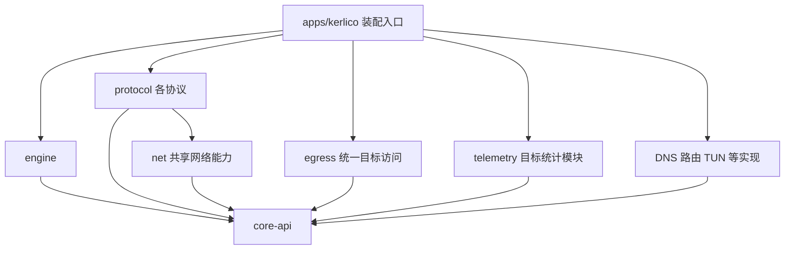

# 项目结构与单文件交付规划

状态：目标布局与取舍，更新日期2026-11-02，Asia/Shanghai。当前只同步设计，代码与验证保留停止快照；真实范围见[实现接口](interfaces/README.md)和根STATUS，未来目标不代表已有功能。

## 目标与“单文件”的含义

源码按功能和协议分开，最终由一个程序入口装配并链接为一个可执行文件。源码文件数量、库 crate 数量和发布的可执行文件数量是不同概念；Rust 允许一个 crate 的模块分布在多个源文件中，库 crate 可由二进制 crate 使用。依据：[Rust 的 package 与 crate](https://doc.rust-lang.org/book/ch07-01-packages-and-crates.html)、[Rust 链接方式](https://doc.rust-lang.org/reference/linkage.html)。

当前把用户的“单文件”解释为**单一可执行程序交付**，仍待用户纠正或确认。各目标系统和 CPU 架构分别构建；系统库、TUN 驱动、权限或移动端宿主的要求需按平台确定。配置、规则集和缓存是否允许使用外部文件，是另一项产品选择。Rust 的 C runtime 链接方式也与目标有关，不能把单个程序文件理解为所有平台都无外部运行条件。依据：[C runtime 的静态与动态链接](https://doc.rust-lang.org/reference/linkage.html#static-and-dynamic-c-runtimes)。

建议采用 **Cargo workspace + 按职责划分的库 package + 一个二进制 package**。协议以独立 package 隔离，功能内部再按普通 Rust module 分文件；不要求每个小模块都变成一个 package。workspace 负责统一管理成员、锁文件与构建设置。依据：[Cargo workspaces](https://doc.rust-lang.org/cargo/reference/workspaces.html)。

这比单 crate 增加清单和接口维护成本，但能约束依赖边界并支持选择性编译。当前已按 [0003](decisions/0003-vless-first-implementation.md) 建立最小 workspace；实际接口见[实现文档](interfaces/README.md)，后续功能按需要增加。

## 客户端与服务端一体

用户已确认共用同一套内核和同一个可执行程序，按配置启用客户端接入、服务端节点，或同时启用两者；依据见 [0006](decisions/0006-unified-client-server-core.md)。客户端路径为本机接入 → engine → 统一目标访问服务 → 协议出站；服务端路径为协议入站节点 → engine → 统一目标访问服务 → 直连或上游出口。

2026-11-01进一步确认全局共享运行出站模块，以及每节点IPv4 only、IPv6 only或双栈模式；双栈缺族由设备共享CF WARP补齐。共享调度器先区分本地出网和远端透传，本地应用节点模式，远端保留原目标并执行远端策略。所有权与模式边界见[0009](decisions/0009-global-egress-dispatcher.md)、[0010](decisions/0010-node-egress-modes-and-warp.md)；这些目标尚未完成源码迁移，具体流量图统一维护在[节点与统一出站](node-egress.md)。

协议模块可同时提供入站、出站，共享编解码，分别维护角色能力、配置、鉴权与生命周期。新增服务端角色不能复制一套协议无关的 DNS、选路和 IPv4/IPv6 候选逻辑。

服务端IPv4、IPv6节点分别建立、凭据独立；目标访问进入同一个独立egress运行调度器。本地目标路径按节点单栈/双栈模式选择原生或设备共享WARP出口，双栈默认IPv4优先；远端路径保留原目标并交远端处理。节点接入地址族与目标地址族独立。详细契约和实现差距见[节点与统一目标访问](node-egress.md)。

## 目标目录

下面是逐步建立的目标布局，包含已存在和未来部分，不表示全部模块均已实现。当前已写入21个协议模块及所需框架；实际角色和验收范围见[总表](../reference/reports/三核心%20协议%20组合支持.md)及[接口文档](interfaces/README.md)。目标目录名仅作布局建议，不预建尚未确认的新模块。

```text
kerlico/
├── .gitconfig                    # 已有：固定匿名 Git 身份与钩子位置
├── .gitignore
├── .githooks/                    # 已有：匿名仓库管理校验，不属于 VPN 实现
├── AGENTS.md
├── README.md
├── STATUS.md                     # 当前进度与待决项
├── Cargo.toml                    # 已有：workspace 清单
├── Cargo.lock                    # 已有：Cargo 依赖锁定
├── apps/
│   └── kerlico/                   # 唯一的可执行程序 package
│       ├── Cargo.toml
│       ├── src/
│       │   ├── main.rs           # 入口、退出状态；保持简短
│       │   ├── cli.rs            # 命令行参数与配置位置
│       │   └── assembly.rs       # 选择、注册并连接各模块
│       └── tests/                # 完整程序的集成测试
├── crates/
│   ├── core-api/                 # 共享类型与模块接口
│   ├── engine/                   # 调度、会话与生命周期
│   ├── telemetry/                # 目标：共享身份归属、流量带宽、访问记录与保存
│   ├── config/                   # 配置文档、通用校验与装配计划
│   ├── egress/                   # 已有：统一目标访问、候选安排与出口建立
│   ├── net/                      # 拨号、可复用传输与安全层
│   ├── routing/                  # 匹配规则、规则集与路由动作
│   ├── dns/                      # 解析、缓存与可选 Fake-IP
│   ├── platform/                 # OS/宿主适配
│   ├── tun/                      # TUN 入站与用户态栈适配
│   ├── builtin/                  # direct/reject 等基础处理器
│   ├── policy/                   # 按需：策略组、健康检查、资源提供器
│   ├── control/                  # 按需：控制接口适配
│   ├── protocol-socks5/          # 协议独立 package，名称仅作示例
│   ├── protocol-trojan/
│   └── protocol-vless/
├── testdata/                     # 按需：共享报文样本和互通数据
├── docs/
│   ├── README.md
│   ├── anonymity.md
│   ├── architecture.md
│   ├── core-contracts.md
│   ├── data-paths.md
│   ├── runtime-lifecycle.md
│   ├── protocol-modules.md
│   ├── protocol-roadmap.md
│   ├── repository-workflow.md
│   └── decisions/
│       ├── README.md
│       ├── 0001-development-sequence.md
│       └── 0002-support-catalog-before-implementation.md
└── reference/
    ├── README.md                 # 固定上游基线与资料导航
    ├── design-map.md             # 证据到本项目设计的映射
    ├── research_notes/           # 保留现有独立调研路径
    ├── reports/                  # 保留现有横向报告
    └── .upstream/                # 未来按需下载的只读源码缓存，忽略提交
```

库 package 通常具有自身的 `Cargo.toml`、`src/lib.rs` 和按需建立的 `tests/`。单元测试随实现模块维护；跨模块与程序级集成测试归属相应 package。根目录是虚拟 workspace 时，不能指望根目录的 `tests/` 自动成为测试目标，故本方案将程序级测试放在 `apps/kerlico/tests/`。

除协议外，不确定的功能也可以先是所属 package 内的 module，再在确有独立依赖、可选构建或复用需要时拆成 package。第一轮实现不需要一次建立整棵树。

## 每层的责任

| 位置 | 负责 | 边界 |
| --- | --- | --- |
| `apps/kerlico` | 启动参数、构建能力清单、模块注册和装配 | 唯一了解本次发行包含哪些具体协议的入口；不实现协议报文 |
| `core-api` | 地址、会话上下文、流/数据报语义、模块能力、生命周期与服务接口 | 不依赖 engine、具体协议、OS 后端或配置文件格式；内部接口不是跨版本二进制插件 ABI |
| `engine` | 入站与会话调度、共享出站装配、取消和状态汇总 | 协调自身资源生命周期；不按节点重建出站，不关闭设备共用WARP |
| `telemetry`，目标模块 | 可信归属下的流量、带宽、在线与访问记录，保存及查询视图 | 每Engine共享，业务量唯一计量；不复制出站或按日志文本重建身份，模块目录尚未创建 |
| `egress` | 唯一调度器与命名出站表、本地/远端分支和通道建立 | 本地按节点模式取设备出口，远端保留原目标；不在engine再维护一套出站表 |
| `config` | 外层配置解析、引用/重复标签校验、模块装配计划 | 协议字段的解码和专属校验归协议工厂；不维护装着所有协议配置的中央枚举 |
| `net` | 连接器、基础传输、可复用安全能力、网络 I/O 辅助 | 通过接口请求解析和平台服务；不决定业务路由，不承载所有杂项工具 |
| `routing` | 根据上下文与解析结果生成路由动作 | 不直接建立业务连接，也不反向依赖 DNS 实现 |
| `dns` | 解析、缓存、Fake-IP 映射及 DNS 自身策略 | 通过服务接口选择连接路径；不依赖具体代理协议或 engine 实现 |
| `platform` | 设备/FD、路由和系统 DNS 操作、防回环与网络变化适配 | 按目标提供实现；移动端可能由宿主提供能力，不能视为纯 CLI 环境 |
| `tun` | IP 包入口、栈适配、与核心流/数据报路径衔接 | 不重复实现 SOCKS/VLESS 等代理协议；网络栈选型另议 |
| `builtin` | 直连、拒绝等基础动作的实现与注册描述 | 与其他处理器遵守相同接口；直连通过 net 连接器工作 |
| `policy` | 出站选择、健康观测、资源加载等子模块 | 节点资源、选择策略和存活检测分别维护，不把它们混成一个大管理器 |
| `control` | 将外部控制请求适配到核心控制接口 | 不能直接修改协议私有状态；是否提供 REST/gRPC 尚未选择 |
| `protocol-*` | 协议配置、握手、鉴权、编解码和入/出站适配 | 常规模块独立；ShadowTLS等显式组合保留并说明内层依赖，不依赖app或engine实现 |

这些是建议的责任划分，不是所有功能都可任意删除的承诺。基础接口和调度属于必需部分；DNS、TUN、控制 API 等是否可省略，要结合本次产品模式及配置依赖判断。

## 编译依赖与运行时协作

下图箭头表示**编译依赖**，不是流量方向。实现通过注入的接口协作，装配入口负责把它们连接起来。



现有工厂与注册边界在`config`，共享I/O契约在`core-api`，具体工厂由app显式注册。继续保持config不反向引用所有协议、协议不依赖engine/egress实现的约束。目标架构由engine管理接入和会话，唯一共享egress协调路由、DNS与出口，彼此通过窄服务契约协作，避免crate循环依赖。

建议的数据路径为：接纳时固定入站配置代次，入口产生会话及原始目标，完成必要的 Fake-IP 恢复、可行的嗅探与分阶段路由，再选择出站和连接器，进入 TCP 流或 UDP 数据报转发，最后回写与回收。具体顺序要尊重协议的成功响应和首包时序；DNS 查询本身也需要独立的解析与拨号路径，避免引导解析和代理连接相互递归。详细阶段见[数据路径](data-paths.md)。

TCP与UDP保持独立语义：TCP需要半关闭与双向任务协调；UDP需要逐包地址、会话映射、超时、有界队列与回写信息。不能把两者压成没有包边界的字节流。未来原始IP隧道或专属栈endpoint需要各自边界，不能强塞进TCP代理接口。上述问题来自[横向调研](../reference/reports/Rust%20VPN%20内核参考调研.md)；已有流、固定UDP及关联签名见接口，最新共享服务的内部类型仍待迁移设计。

## 插拔与单文件如何同时成立

多用户及统计按[0011](decisions/0011-users-statistics-and-access-records.md)和[统计设计](statistics-and-users.md)适配。节点鉴权后绑定稳定管理用户与逻辑会话，贯穿唯一Dispatcher；统计运行服务共享，业务、载体和设备量分开。持久历史与访问记录不属于节点私有状态，协议工厂不能各建一套存储。

| 操作 | 建议机制 | 对发布物的影响 |
| --- | --- | --- |
| 构建时不包含某协议 | app 的可选依赖、feature 与条件注册 | 重新构建单个程序；该协议不进入本次产品依赖路径 |
| 在配置中选用已包含协议 | 注册表按类型构建实例，并验证能力与引用 | 使用同一程序；是否运行中生效另由生命周期设计决定 |
| 后续开发新增协议 | 新增协议 package，并在 app 添加依赖、feature 与注册 | 发布包含新能力的新程序；核心调度无需认识新协议名称 |
| 运行中装载全新协议代码 | 需要额外的动态库/插件执行边界设计 | 本方案不提供此机制，不能把它与配置选用混为一谈 |

Cargo features 用于条件编译和可选依赖，其启用会在相关依赖图中合并，因此要采用“增加能力”的设计，并核查实际依赖闭包；配置里不使用某协议不会自动把代码移出二进制。依据：[Cargo features](https://doc.rust-lang.org/cargo/reference/features.html)。

这份规划采用编译进程序的模块。运行中启停已有实例、配置替换、旧连接排空与新代码装载是不同问题。第一版建议先保证完整启动、停止与失败清理；在线更新按变更类别逐项开放，未声明支持的变更返回需要重启。会话与 UDP 关联固定代次，监听器、TUN 和 Fake-IP 映射由独立资源使用期管理。详见[运行与配置生命周期](runtime-lifecycle.md)。若未来确实要求跨版本动态库插件，需要单独设计 ABI；Rust 原生 ABI 本身没有稳定性保证。依据：[Rust ABI](https://doc.rust-lang.org/reference/items/external-blocks.html#abi)。

## 按需求逐步建立

1. 客户端/服务端一体方向已确认，框架和21个协议模块已形成开发快照；各自角色、交付边界及限定验证见接口和STATUS。
2. 当前保留代码与验证停止状态，本轮只更新共享出站、节点模式和WARP设计；不从旧框架或协议任务自动恢复实现。
3. 恢复后按明确任务迁移共享所有权和本地/远端责任边界，保护已有认证、流/包和资源行为；新架构另行验证，不能继承旧结果。
4. 协议后续工作仍按总表和0007流程，先复核完整交付范围，集中写完首轮代码与接口，再统一worker验证、修改及复验。
5. TUN、DNS高级模式、策略组与控制接口按产品需求单独排期，不把目录规划视为已支持能力。

实现阶段的结构验收包括：每个目标的交付文件与动态依赖核查；协议独立构建与互通；被裁剪能力在配置中被明确拒绝；UDP/关闭/错误路径资源回收；配置引用和拨号依赖环检测。它们是未来的验收方向，本轮没有创建或运行代码测试。

## 待决项

仍待明确的是额外嵌入资源要求、正式发行平台、移动端宿主、上游配置兼容及在线更新范围，以及新WARP接入方式和单栈缺族是否自动补齐。当前代码已采用Tokio、JSON v1及具体crate命名，声明工具链以Cargo和STATUS为准，不能继续写成全部未定。已有协议的角色和限定验证按接口记录，不将新共享架构当作已完成。

## 细化文档

| 主题 | 进一步约定 |
| --- | --- |
| [双端与统一目标访问](node-egress.md) | 共用核心、节点模式、共享WARP及远端透传 |
| [核心契约](core-contracts.md) | 会话标识、分阶段元数据、工厂与窄服务、能力校验、未来文件职责 |
| [数据路径](data-paths.md) | TCP 确认与嗅探时序、UDP 关联/目标流/端点、DNS 防环和 Fake-IP 回写 |
| [运行与配置生命周期](runtime-lifecycle.md) | 启动状态、配置代次、资源 lease、更新分级和任务退出 |
| [协议模块与插拔](protocol-modules.md) | 协议内部结构、注册/构造计划、能力裁剪、新增与移除 |
| [协议与组合总表](../reference/reports/三核心%20协议%20组合支持.md) | 统一支持清单、组合限制与任务编号 |
| [协议阶段与路线](protocol-roadmap.md) | 框架验收与逐项开发的工作流 |

当前已有21模块开发快照，角色、组合及未完成项见接口和STATUS。旧结果不验证最新共享出站与WARP目标，不预建空协议或将目标目录视为已有功能；本轮仅同步文档。

## 借鉴依据与维护

关联[借鉴映射](../reference/design-map.md)的 REF-003（装配）、REF-004（策略与资源）、REF-005（分层）和 REF-008（平台边界）。具体 Rust 模块划分仍是本项目草案，不表示完整移植某个上游。

文档、状态、重要决策和源码缓存的存放方式统一见[仓库文档约定](repository-workflow.md)，实际进度见 [STATUS.md](../STATUS.md)。
