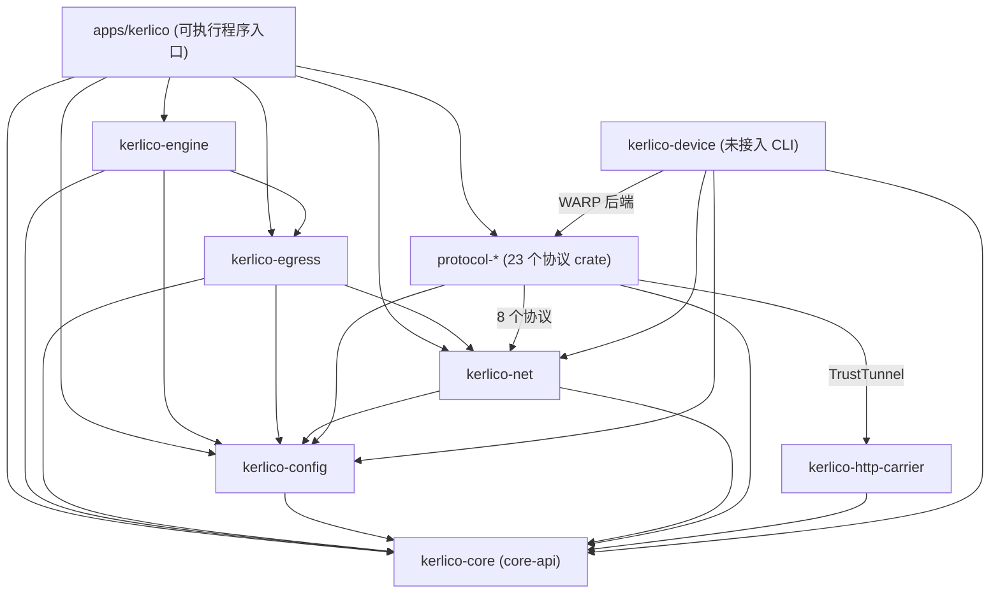

# 项目结构与单文件交付规划

更新日期：2026-11-02（Asia/Shanghai）

本文描述 `kerlico` 的 Cargo workspace 组织、模块职责划分与单可执行文件交付方式。当前已实现模块与接口契约见 [实现接口](interfaces/README.md) 与 [STATUS.md](../STATUS.md)。

## 单一可执行文件与模块化源码

项目源码按职责和协议拆分为多个库 crate，最终由二进制入口 `apps/kerlico` 装配并链接为**单个可执行程序**（参考 [Rust Packages and Crates](https://doc.rust-lang.org/book/ch07-01-packages-and-crates.html)、[Linkage](https://doc.rust-lang.org/reference/linkage.html)）。

采用 **Cargo workspace + 职责库 package + 单一二进制 package** 的原因：

- 约束跨模块编译依赖边界，防止循环依赖；
- 每个协议独立为一个 package，支持通过 Cargo features 进行编译期裁剪；
- 统一管理依赖版本（`Cargo.lock`）与 workspace 级 lints（`unsafe_code = "forbid"`）。

## 客户端与服务端一体

同一套内核与同一个可执行程序按配置启用客户端接入、服务端节点或同时启用两者（见 [0006](decisions/0006-unified-client-server-core.md)）：

- **客户端路径**：本地入口（`inbounds` / `local_inbounds`）→ `engine` → 全局共享出站调度器（`egress`）→ 远端代理出站。
- **服务端路径**：协议节点（`nodes`，IPv4/IPv6 独立建立与鉴权）→ `engine` → 全局共享出站调度器（`egress`）→ 本地直连/设备 WARP 或上游远端代理。

各协议 crate 可同时包含入站与出站实现，共享报文编解码，分别注册客户端与服务端工厂。

## 目录结构

以下包含当前已有目录与规划中的扩展模块（标注为“规划”的 crate 尚未创建）：

```text
kerlico/
├── .gitconfig                    # 固定匿名 Git 身份与钩子配置
├── .gitignore
├── .githooks/                    # 匿名与隐私校验钩子
├── AGENTS.md                     # 协作约定与工程规范
├── README.md / README.en.md      # 中英文项目入口
├── STATUS.md                     # 项目进度与验证状态汇总
├── Cargo.toml / Cargo.lock       # Workspace 清单与依赖锁
├── apps/
│   └── kerlico/                  # 唯一可执行程序入口 (CLI + 模块注册装配)
├── crates/
│   ├── core-api/                 # 共享核心类型、流/数据报契约、身份与生命周期接口
│   ├── config/                   # JSON v2 配置解析、账户/凭据隔离校验与装配计划
│   ├── engine/                   # 监听绑定、会话接纳、配额与优雅排空调度
│   ├── egress/                   # 全局共享 Dispatcher、Local/Remote 分流与 Telemetry 计量
│   ├── net/                      # Direct/Reject 出站、TcpConnector、NativeDevice
│   ├── device/                   # 同进程 WARP 设备所有者 (CLI 未接入)
│   ├── http-carrier/             # H2/H3 DATA 流与 QUIC 运行时 (TrustTunnel 使用)
│   ├── protocol-*/               # 23 个独立协议 crate (vless, trojan, vmess, hy2, wg, tor 等)
│   ├── routing/                  # (规划) 规则匹配与路由动作
│   ├── dns/                      # (规划) 独立 DNS 解析、缓存与 Fake-IP
│   ├── tun/                      # (规划) 系统 TUN 入站适配
│   ├── platform/                 # (规划) 宿主/OS 网络与防回环操作
│   ├── policy/                   # (规划) 出站选择组与健康观测
│   └── control/                  # (规划) 外部控制与查询接口适配
├── third_party/                  # 局部补丁依赖 (h3, shaped-rustls, xray-transport, ml-kem-legacy)
├── tools/                        # 对端互通与基准测试辅助工具
├── docs/                         # 架构设计、决策记录、接口文档与测试报告
└── reference/                    # 上游核心固定源码调研与借鉴映射
```

## 各层职责边界

| 模块 | 核心职责 | 边界约束 |
| --- | --- | --- |
| `apps/kerlico` | CLI 参数解析、构建能力清单、显式注册协议工厂、启动 `Engine`、`history` 与 `account-new` 命令 | 唯一感知本次构建启用了哪些协议的入口；不实现协议报文处理 |
| `core-api` | 地址、会话身份、流/数据报通道、`Outbound`/`InboundProtocol`、错误与取消/回收契约 | 不依赖 `engine`、具体协议或配置文件格式 |
| `config` | JSON v2 外层解析、管理账户与凭据隔离校验、`Registry` 与工厂 trait、生成 `PreparedConfig` | 协议私有选项交由对应工厂编译，不维护包含所有协议的中央配置枚举 |
| `engine` | 监听绑定、会话配额、节点取消域管理、协调 `EgressRuntime` 启停排空 | 不按协议名称分支，不按节点重复构造出站实例 |
| `egress` | 唯一 `Dispatcher` 与命名出站表、`Local`/`Remote` 目标策略、业务流量计量（`Telemetry`）与 SQLite 历史 | 每个节点固定绑定一个命名出站；`Local` 按节点地址族模式解析并拨号，`Remote` 保留原始目标透传 |
| `net` | `direct`/`reject` 基础出站、`TcpConnector`、原生设备 | 不决定业务路由策略 |
| `device` | 同进程 WARP 所有者，实现 `DeviceNetwork` | 发行二进制未依赖，当前只有自身测试调用 |
| `http-carrier` | H2/H3 DATA 流与 QUIC 运行时 | 不含鉴权、路由与计量 |
| `protocol-*` | 协议专属配置解码、握手鉴权、报文编解码、入站节点与出站连接实现 | 依赖 `core-api` 与 `config`，8 个还依赖 `net`；不依赖 `engine` 或 `egress` |
| `routing` / `dns` / `tun` / `platform` / `policy` / `control` | 规划中的规则路由、独立 DNS/Fake-IP、系统 TUN、宿主适配、策略组与控制 API | 按后续阶段逐步拆分建立 |

## 编译依赖关系

下图箭头表示**编译期 crate 依赖方向**（运行时通过 `core-api` trait 接口注入协作，保持无环依赖）：



## 编译裁剪与配置选用

| 操作场景 | 实现机制 | 对产物的影响 |
| --- | --- | --- |
| 构建时裁剪某协议 | 通过 `apps/kerlico` 的 Cargo features 控制可选依赖与条件注册 | 重新编译生成不包含该协议代码的单一可执行文件 |
| 运行时选用已编译协议 | `Registry` 按配置中的 `type` 查找已注册工厂并构造实例 | 使用同一可执行文件，通过配置文件启用所需入站/出站 |
| 新增协议模块 | 新增 `crates/protocol-<name>`，在 `apps/kerlico` 添加 feature 与注册 | 核心 `engine` 与 `egress` 无需按新协议名修改调度逻辑 |

## 关联文档与借鉴依据

- **细化设计**：[双端与统一目标访问](node-egress.md) · [多用户与统计](statistics-and-users.md) · [核心契约](core-contracts.md) · [数据路径](data-paths.md) · [运行与配置生命周期](runtime-lifecycle.md) · [协议模块](protocol-modules.md)
- **上游借鉴**：关联 [借鉴映射](../reference/design-map.md) 中的 `REF-003`（装配）、`REF-004`（策略与资源）、`REF-005`（分层）与 `REF-008`（平台边界）。
