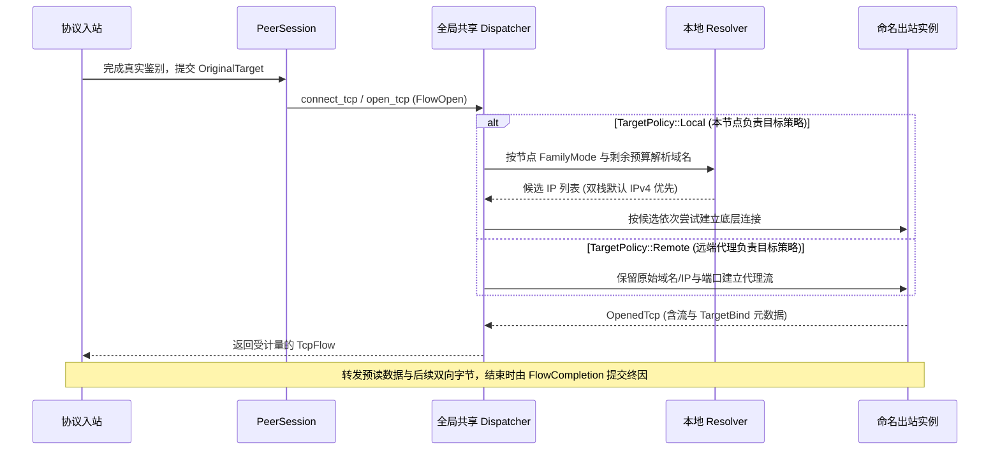

# TCP、UDP、TUN 与 DNS 数据路径

更新日期：2026-11-02（Asia/Shanghai）

本文定义 `kerlico` 中 TCP 流、UDP 数据报（固定目标与多目标关联）、DNS 解析及规划中 TUN 入站的数据转发路径与时序约束。当前已落地接口见 [核心接口](interfaces/core.md) 与 [节点与共享目标访问](interfaces/node-egress.md)。

## 通用路径约束

1. **端到端建立预算**：建立超时预算（`connect_timeout_ms`）从接纳请求开始计算，产生绝对截止时间（deadline）；后续解析、拨号与协议握手共享剩余预算，子步骤不重置总超时。
2. **本地与远端策略分流**：所有入站请求经 `PeerSession` 进入全局唯一 `Dispatcher`：
   - **`TargetPolicy::Local`**：按入站节点的 `FamilyMode`（`ipv4-only`、`ipv6-only`、`dual-stack` 默认 IPv4 优先）解析目标域名并选择本地原生或设备共享 WARP 出口。
   - **`TargetPolicy::Remote`**：保留原始请求域名/IP 与端口交由所选远端代理编码，本机不对网站目标调用本地 DNS；远端失败直接按协议返回或结束会话，不触发本机换族或回退重试。
3. **唯一业务计量**：上传与下载字节仅在 `Dispatcher` 包装的逻辑业务通道（`TcpFlow`、`FixedUdpFlow`、`UdpAssociation`）处计量一次，预读或分片重组不重复累加。

## TCP 数据路径

| 阶段 | 负责模块 | 行为与边界 |
| --- | --- | --- |
| 1. 接纳与鉴别 | `engine` + 入站协议 | 申请全局与节点会话配额，建立 Peer 取消域；完成协议握手与真实线格式鉴别后签发 `PeerSession` |
| 2. 准入与选路 | `Dispatcher` (`FlowOpen`) | 首次 poll 时检查 `stop_admission` 状态，确定命名出站及 `Local` / `Remote` 分支，创建唯一 `FlowLease` |
| 3. 目标建立 | `Dispatcher` + 命名出站 | `Local` 路径在剩余预算内按节点模式尝试候选 IP；`Remote` 路径透传原始目标建立代理流 |
| 4. 响应确认 | 入站协议 | 将就绪通道或建立错误交还入站协议（如 SOCKS5/HTTP CONNECT 返回成功或失败响应） |
| 5. 双向转发 | `relay_tcp` / `relay_tcp_io` | 先转发握手阶段预读的早期业务字节，再执行双向异步复制并更新唯一业务计量 |
| 6. 完成与回收 | `FlowCompletion` + 作用域 | 报告真实终因（`DuplexEof`、`ProtocolEnd` 或 `Failed`），释放 I/O 半部、配额租约与任务句柄 |

### 半关闭（TCP EOF）与首包时序

- **半关闭语义**：当一侧读到正常 EOF 时，完成对向待写缓冲后关闭对端写方向，反向继续读取直至对端完成或关闭预算耗尽（遵循 [RFC 9293 Section 3.6](https://www.rfc-editor.org/rfc/rfc9293.html#section-3.6)）。出站是否支持将写关闭传播至最终目标由 `Capabilities.tcp_eof` 声明，供 `require_remote_eof` 校验。
- **首包与预读**：客户端等待代理响应后才发首包的协议（如 SOCKS5、HTTP CONNECT）不阻塞等待业务首包；支持首包携载的协议在握手解码后将剩余预读字节无损移交转发循环。

## UDP 数据路径：固定目标与多目标关联

UDP 区分三层状态，保持完整数据报边界（空包作为 0 字节有效数据报传递，`None` 表示通道结束）：

| 层级 | 状态与职责 | 生命周期边界 |
| --- | --- | --- |
| 固定目标通道 (`FixedUdpFlow`) | 绑定单一目标地址，拆分独立发送/接收半部与 `FlowCompletion` | 单次固定 UDP 转发会话，受空闲超时与取消域约束 |
| 多目标关联 (`UdpAssociation`) | 绑定入站用户/节点身份与单一命名出站，支持逐包指定不同目标（Full Cone 语义） | 随控制连接或关联空闲期限存续；关联建立后固定所选出站，不跨代理切换 |
| 本地目标绑定缓存 | `Local` 多目标关联首次向某目标发送时按节点模式解析并缓存目标 IP（上限 256 个目标） | 关联存活期内复用同一解析绑定，达上限时明确拒绝新目标 |

## DNS 与 TUN 扩展路径（规划设计）

- **独立 DNS 模块（规划）**：区分本地网站目标解析、代理载体端点解析与未来路由规则匹配辅助解析；代理端点拨号与 DNS 引导查询使用独立连接路径，防止递归死循环。Fake-IP 映射由独立租约管理。
- **系统 TUN 入站（规划）**：通过用户态网络栈（如 `smoltcp`）将三层 IP 包还原为 TCP 流与 UDP 数据报接入 `Dispatcher`；目前用户态栈能力已在 `protocol-wireguard` 内部用于端到端隧道封装与解封装。

## 关联文档与借鉴依据

- **细化文档**：[核心契约](core-contracts.md) · [节点与统一出站](node-egress.md) · [运行与配置生命周期](runtime-lifecycle.md)
- **上游借鉴**：关联 [借鉴映射](../reference/design-map.md) 的 `REF-001`（目标信息）、`REF-002`（TCP/UDP）、`REF-006`（DNS/Fake-IP）与 `REF-008`（TUN）。
