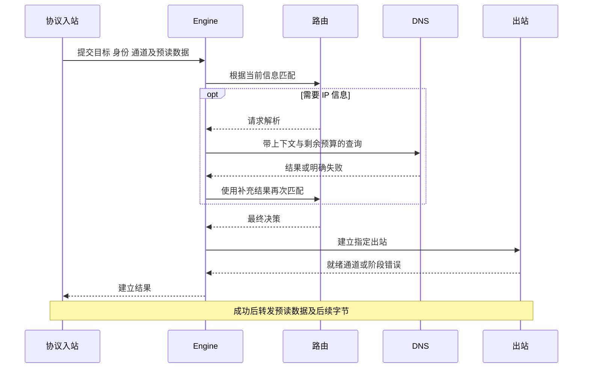

# TCP、UDP、TUN 与 DNS 数据路径

状态：本轮架构建议，2026-10-30。文中的步骤是目标行为，尚无实现。公共对象见[核心契约](core-contracts.md)，更新与退出见[运行生命周期](runtime-lifecycle.md)。

## 每条路径都要保持的约束

入口身份、原始目标、配置代次和已消费数据必须可追踪。业务目标、代理服务器目标和 DNS 服务器目标分开处理；连接代理服务器不能再次无条件进入同一套业务路由。一次阶段推进必须得到新信息或结束，解析、嗅探与路由之间不能无限循环。

建立预算从接纳会话开始计算，DNS、嗅探、拨号和握手只能使用剩余预算，子步骤不能各自重新获得完整总超时。转发阶段另有空闲和关闭预算；具体值随产品范围确定。

## TCP：先完成接入与出站建立，再进入转发

| 阶段 | 所有者 | 行为与结果 |
| --- | --- | --- |
| 接纳 | 入站与接入闸门 | 先固定所属入站和配置代次，限制新连接并创建取消作用域；以同一绑定完成必要的头部解码与鉴权，输出原始目标 |
| 关联上下文 | engine | 验证提交的代次和入站绑定；保存原始信息与需要的映射租约，不在此重新取最新配置 |
| 补充观察 | engine 与入口适配 | 在协议允许且预算充足时嗅探；返回观察与所有预读数据，不隐式改拨号域名 |
| 形成决策 | engine、routing、DNS、policy | 规则匹配可请求额外解析，显式推进后形成拒绝或出站决策；固定本次选择 |
| 建立 | 出站、net | 获取被选中的实例与资源 lease，解析必要的服务器地址、保护 socket、连接并完成协议握手 |
| 确认 | engine、入站 | 将已就绪通道或失败交还入站；需要成功/失败响应的协议由入站按其规范编码 |
| 转发 | relay、协议 I/O 适配 | 先处理尚未转发的预读字节，再双向复制；记录错误、半关闭和结束原因 |
| 回收 | 会话作用域 | 释放任务、流、映射和资源 lease；统计只结算一次 |

下面仅示意代理 TCP 会话，省略拒绝和取消分支。嗅探、DNS 都是按需阶段，不能据图要求所有连接必须等待域名解析。

### 嗅探、首包与确认时序

预读缓冲带来源、长度与消费位置，只允许有一个推进者。嗅探只观察副本或受控视图；转发时每个业务字节恰好交付一次。解析失败、达到上限和没有足够信息要分别返回，不能吞掉首包后再当作普通连接继续。

有些客户端会等待代理成功响应才发送业务数据；这时在响应之前等待 TLS/HTTP 首包会形成等待环。入站必须说明当前阶段是否允许预读。建议默认不为了嗅探而提前宣告连接成功：不可取得首包时按已声明的缺失信息策略匹配；若规则强制要求该信息，则明确失败。需要提前响应的扩展模式另行讨论其失败可见性。

服务端先发数据的协议也不能被强制等待客户端首包。TUN 用户态栈对本地应用的 TCP 确认与代理出站建立是不同层级，不能简单套用代理监听器的成功响应。

### 半关闭、错误与重试

一侧读到正常 EOF 时，让对应方向完成待写数据并关闭对端写方向；反向仍可接收数据，直到对端完成或关闭预算耗尽。严重 I/O/协议错误与显式取消则按会话策略终止相关任务。TCP 的关闭具有方向性，不能一侧 EOF 就无条件丢弃反向数据。依据：[RFC 9293：关闭与半关闭](https://www.rfc-editor.org/rfc/rfc9293.html#section-3.6)。

建立失败是否换候选出站，取决于错误阶段、预算和已发生的副作用。协议必须报告是否已发送早期业务数据；数据已经交付远端后，不透明重放到另一个节点。零业务负载的连接失败也需要受限次数，避免连接链与健康检查共同形成重试风暴。

## UDP：关联、目标流与传输端点分别管理

| 层级 | 保存的状态 | 使用期 |
| --- | --- | --- |
| Association，关联 | 入站/用户身份、来源、回写通道、配置代次、准入与总量限制 | 一次协议关联或透明入口的逻辑发送方，受空闲与最大使用期约束 |
| Flow，目标流 | 逻辑目标、映射引用、路由决策、出站引用与该目标的队列 | 关联内一个目标及其路由结果；并发创建要合并 |
| Endpoint，传输端点 | 底层 socket、隧道、复用通道或目标绑定 | 由协议实现按能力共享；不强制一个目标独占一个 socket |

关联不是一个固定目的地址。一个入站 UDP 关联可以发送到多个目标，多个目标也可能需要不同出站。核心应保留这种能力；底层端点能否共享、是否支持逐包目的地和回包来源，则必须查能力与实例约束。

建议关联 key 包含入口实例、隔离命名空间、来源/认证身份和入口分配的关联标识；目标流 key 再加入逻辑目标与代次。不能只用源端口作为全局 key。具体 key 根据接入协议提供的信息确定；未经可信关联的报文不能自行挑选别人的关联 ID。

具有控制连接的协议，其 UDP 关联继承该控制会话的配置与认证绑定；透明 UDP 入口则在接纳新的独立关联时固定代次。不能让旧控制会话在处理同一请求时突然取得新版本的鉴权或出站集合。

### 每个数据报的路径

1. 入站校验完整报文与发送方关联，输出拥有负载的包、逻辑目标和回写凭据。协议分片若被支持，应先在受限范围内重组，不能把半个逻辑包交给核心。
2. engine 查找关联及目标流。尚未建立目标流时，合并同 key 的并发创建，把首批包放入有界队列；网络等待不能持有关联表的全局锁。
3. 首包按固定代次完成必要的 Fake-IP 恢复、观察、解析与选路，并获取对应出站；后续包复用有效的决策，目标改变则定位另一条流。
4. 出站按自己的单/多目标能力选择端点，交接完整数据报与地址信息。不能为适配字节流接口而丢弃边界；底层使用 TCP 的协议仍需自行实现完整的包 framing。
5. 回包携带实际来源和关联凭据，核对流与关联仍存活；入口使用被固定的回写语义生成响应。Fake-IP 或透明接入所需的原始地址映射不能被远端实际 IP 覆盖。
6. 超时或关闭时先从查找表移除，标记该关联/流的使用期结束，再处理队列、取消收发任务并释放资源。迟到的 DNS、拨号或回包不能复活已经结束的条目。

包缓冲、回写凭据和映射租约一起交接。关联表里可以保留轻量索引，不保留指向已归还缓冲池内存的借用。是否需要一次关联内按包重新选路，属于额外模式；本轮建议保持每条目标流的决策稳定，避免往返映射随包漂移。

### 队列、容量与映射行为

为全局、每关联和每目标流分别设置包数/字节数/并发建立上限，并定义单包大小、空闲、总使用期和分片重组预算。默认溢出建议丢弃新到的完整数据报并计数，不能无限等待或只发送半包；对不能阻塞的 TUN 入口尤其要保持处理边界。具体产品可以选择其他有界策略，但必须明确说明。

某个目标不可达通常只结束该流，不能自动摧毁同一关联的所有目标。底层共享端点失效时，由所有者通知其使用流失效，并按受限策略重建。首包在网络发送完成前后的失败需要区分，不能自动重发一个可能已经送达的 UDP 包。

端点共享和映射规则决定源端口及回包接受范围。本轮不承诺所有出站都有同一种 NAT 行为；上游中存在的 Full-cone 入口机制也不能推出端到端等价。相关证据见 [Xray 调研](../reference/research_notes/Rust%20VPN%20内核参考调研/xray.md)。

## DNS：解析职责与业务路由分开

建议查询上下文显式区分应用解析、代理服务器解析和解析器引导，并继承调用者的代次、预算及必要路径约束。业务域名请求 IP 规则评估时，由 routing 返回“需要解析”，engine 调度 Resolver 并带结果继续匹配；routing 不直接引用 dns 实现。

DNS 请求需要走某个出站时，使用明确的 DNS 连接路径，而非从头递归进入相同业务分发。配置计划检查已知依赖环，运行时再记录解析/连接访问链并设置有界深度，以覆盖动态资源变化。未定义的回退应报错，不能自动改走系统直连解析。

缓存 key 除问题本身还要覆盖解析器/策略分区和会影响结果的选项；是否跨代复用应比较语义，而非仅比较域名。成功、否定回答和暂时失败分开记录，不能让旧解析策略的缓存无条件污染新策略。

### Fake-IP 是有使用期的状态

映射存储由独立所有者持有，在入口命名空间内建立域名与假地址的关系。DNS 应答、入口恢复与已建立会话使用同一映射身份。TUN 入口必须能确定对应命名空间，否则无法可靠反查。

活动会话持有映射 lease；DNS TTL 和客户端缓存宽限也会影响地址回收，不能仅因当前没有活动连接就立即把假地址分配给别的域名。旧代次关闭不能直接清空整个池。池范围或持久化格式改变需要单独迁移或重启计划，不能作为普通规则替换处理。

具体持久化、最大回收宽限和池耗尽行为待确定；即使实现了宽限，也不能承诺违反 TTL 的任意客户端缓存永远有效。更换系统 DNS 的操作归平台资源生命周期，不能由 Resolver 在单次查询里临时修改。

## TUN：先明确处理的是哪种数据

TUN 适配器接收 IP 包；所选用户态栈负责把已支持的 TCP/UDP 转成核心的流与数据报接入，再按原始地址语义回写到栈和设备。原始 IP endpoint 是另一条可选路径：只有产品和协议明确需要时才建立契约，不把 ICMP 或任意 IP 协议伪装成 UDP。

栈、平台与协议要分别声明 IPv4/IPv6、MTU、分片、卸载元数据和错误反馈的能力。过大的包如何处理、哪些 ICMP 行为由栈产生，要在选型后核查；仅有 TUN 文件句柄不代表任意 IP 流量都能透明转发。

平台负责设备获取、FD 所有权和受控网络操作，tun 负责包与核心路径适配。移动端可由宿主创建 VPN 接口；借用、复制或接管 FD 必须事先约定。出站 socket 的防回环/保护、绑定接口和网络变化处理归连接器与平台服务协作，不能绕过它们直接创建未受约束的 socket。

## 未来验收场景

| 场景 | 预期可观察结果 |
| --- | --- |
| 等待代理成功响应后才发首包 | 不发生嗅探与握手互等；缺失观察按明确策略处理 |
| 嗅探预读、出站早期数据和正常转发相遇 | 同一业务字节不重复、不丢失，失败可定位消费阶段 |
| TCP 单向 EOF，反向还有响应 | 反向在关闭预算内继续完成 |
| 一个 UDP 关联向两个目标发送 | 地址与回写不串流，允许按能力选择不同出站 |
| 并发首包和过期后的迟到拨号结果 | 同目标建立被合并，过期条目不复活 |
| UDP 队列满或逻辑包过大 | 整包拒绝/丢弃、有明确原因计数，内存保持有界 |
| DNS 路径依赖自身所需出站 | 启动检查或运行时防护明确报告循环 |
| 配置切换时 Fake-IP 仍被使用 | 既有映射不被错误复用，回写身份保持一致 |

这些是后续实现应验证的场景，本轮不创建测试、模拟器或网络实现。

## 借鉴依据

关联[借鉴映射](../reference/design-map.md)的 REF-001（目标信息）、REF-002（TCP/UDP）、REF-006（DNS/Fake-IP）和 REF-008（TUN）。关联/目标流/端点的具体划分和资源交接规则仍是本项目建议，不推定与上游具有完全相同的实现。
