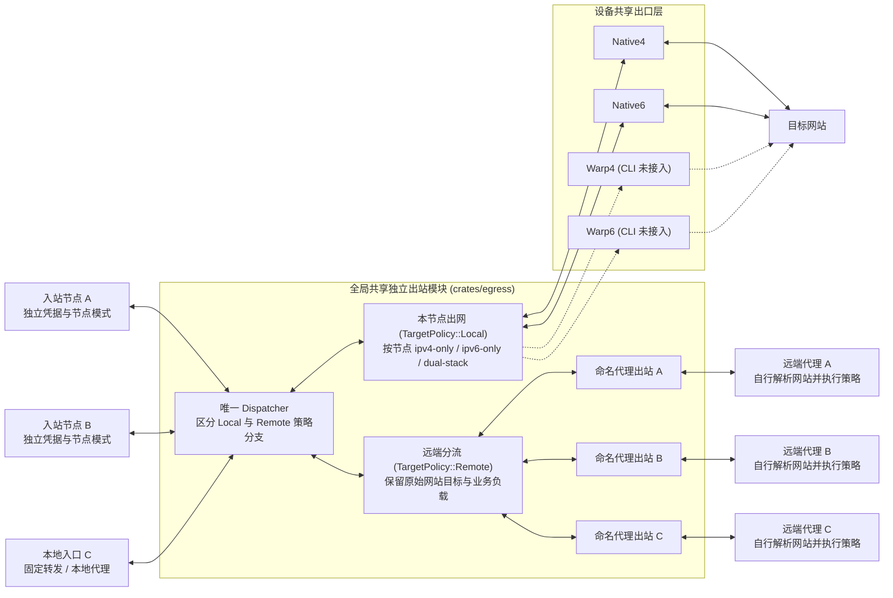

# 客户端、服务端节点与统一目标访问

更新日期：2026-11-02（Asia/Shanghai）

本文定义双端一体架构下的节点隔离、全局共享出站调度器、节点地址族模式、设备级共享 CF WARP 以及远端代理原目标透传规则。设计依据见 [0005](decisions/0005-separate-nodes-unified-egress.md)、[0006](decisions/0006-unified-client-server-core.md)、[0009](decisions/0009-global-egress-dispatcher.md)、[0010](decisions/0010-node-egress-modes-and-warp.md) 与 [0011](decisions/0011-users-statistics-and-access-records.md)；当前已落地接口见 [节点与共享目标访问接口](interfaces/node-egress.md)。

## 同一程序承担两种角色

| 运行角色 | 接入与目标访问路径 |
| --- | --- |
| 客户端 | 本地应用通过固定转发入口（`inbounds`）或本地代理入口（`local_inbounds`）进入核心，由共享出站调度器选用远端代理出站 |
| 服务端 | 远端客户端连接协议节点（`nodes`），完成鉴权与解码后，由共享出站调度器选用本地直连/WARP 或上游代理出站 |
| 同时启用 | 同一 `Engine` 实例同时装配本地入口、服务端协议节点与命名出站表，按会话维护身份归属与资源配额 |

## 节点与目标是两个独立维度

- **入站节点（Node）**：客户端连接的服务端入口。IPv4 与 IPv6 节点分别建立，各自拥有独立的 `NodeId`、监听地址、成员列表（`members`）与协议凭据，拒绝跨节点复用认证或保护秘密。
- **业务目标（Target）**：客户端请求访问的目标域名或 IP（IPv4/IPv6），与入站节点的监听地址族及远端代理载体的端点地址族相互独立。例如 IPv4 入站节点可访问 IPv6 目标网站，反之亦然。

## 统一访问口与全局共享调度器

同一个 `Engine` 运行实例只装配一个全局共享出站模块（`EgressRuntime` / `Dispatcher`），统一持有命名出站实例表。所有入站节点在完成协议握手与真实鉴别后，通过绑定可信身份的 [`PeerSession`](interfaces/core.md) 向唯一 `Dispatcher` 提交目标请求。

- **实例所有权**：每条命名出站配置在运行期只构造并启动一次；节点只持有轻量绑定句柄（`IngressBinding`），不各自持有 `Outbound` 实例、连接池或解析器。
- **连接固定与作用域隔离**：每个 TCP 连接或 UDP 关联在建立时固定所选命名出站，后续包不跨代理重放或切换。代理内部连接池按 `ResourceKey`（命名出站实例 + 来源成员/Local 归属 + 凭据代次）分区隔离。
- **取消域分离**：单次请求取消、单 peer 取消、单节点取消与共享命名服务关闭分别管理；单个节点停止不会关闭其他节点共用的命名出站服务或设备级 WARP。

## 目标地址选择策略

`Dispatcher` 先根据所选命名出站的 `TargetPolicy` 确定属于**本节点出网（`Local`）**还是**远端分流（`Remote`）**，再处理目标地址：

### 1. 三个网络段的地址族解耦

| 网络段 | 地址族决定依据 |
| --- | --- |
| 客户端 → 入站节点 | 入站节点的监听地址与客户端网络 |
| 内核 → 远端代理服务器 | 远端代理端点配置与底层载体拨号连接器 |
| 最终出口 → 目标网站 | `Local` 分支由入站节点 `mode` 与设备出口决定；`Remote` 分支由远端代理自行决定 |

### 2. 本地出网分支（`TargetPolicy::Local`）

仅在本节点承担目标策略的出站（如 `direct` 或 IP 层隧道 `wireguard`）上应用节点的 `mode` 配置：

| 节点模式 (`mode`) | 域名解析候选与出口选择 |
| --- | --- |
| `ipv4-only` | 仅选择 IPv4 目标地址与设备 IPv4 出口；字面 IPv6 目标直接拒绝 |
| `ipv6-only` | 仅选择 IPv6 目标地址与设备 IPv6 出口；字面 IPv4 目标直接拒绝 |
| `dual-stack`（默认） | 同时支持 IPv4 与 IPv6，默认 **IPv4 候选优先**；缺少原生出站族时，目标设计由设备共享 CF WARP 对应族出口（`Warp4` / `Warp6`）自动补齐 |

- **本地多目标 UDP 关联**：首次向某目标发送时按节点模式解析并缓存绑定（每关联最多 256 个目标），后续同目标数据报复用已选地址，不逐包重新解析。
- **设备级共享 WARP（目标设计）**：同一设备统一管理一套 WARP 运行环境并提供 `Warp4` / `Warp6` 逻辑出口，在部署准备阶段完成，配置纯校验（`kerlico check`）不修改宿主网络，Engine 或单节点退出不关闭设备共用 WARP。

### 3. 远端分流分支（`TargetPolicy::Remote`）

当所选出站为远端应用层代理（如 VLESS、Trojan、VMess、Hysteria2、Tor 等）时：

- **原始目标透传**：保留原始请求的网站域名或字面 IP、端口与业务负载，按代理协议线格式编码后交由远端代理处理；本机不对网站域名调用本地 DNS 解析，也不将本节点的单栈/双栈模式强加给远端网站目标。
- **失败不回退**：远端代理建立或转发失败时，按协议向入站返回错误或结束当前会话并回收本地资源，不触发本机换地址族、换其他代理、回退本地直连或 WARP 重试。

## 实现现状与待完成边界

- **已实现（见 [interfaces/node-egress.md](interfaces/node-egress.md)）**：配置 v2 节点成员与凭据隔离（`CredentialManifest`）、`IngressBinding` / `PeerSession` 鉴权交接、全局唯一 `EgressRuntime` / `Dispatcher`、`TargetPolicy::Local`（含 `ipv4-only` / `ipv6-only` / `dual-stack` IPv4 优先及多目标 UDP 256 目标缓存）与 `TargetPolicy::Remote` 原目标透传。
- **待实现**：CLI 接入 `kerlico-device` 以启用 `Warp4` / `Warp6`；出站选择组（Policy Group）与规则路由模块。当前每个节点固定绑定一个命名出站。
