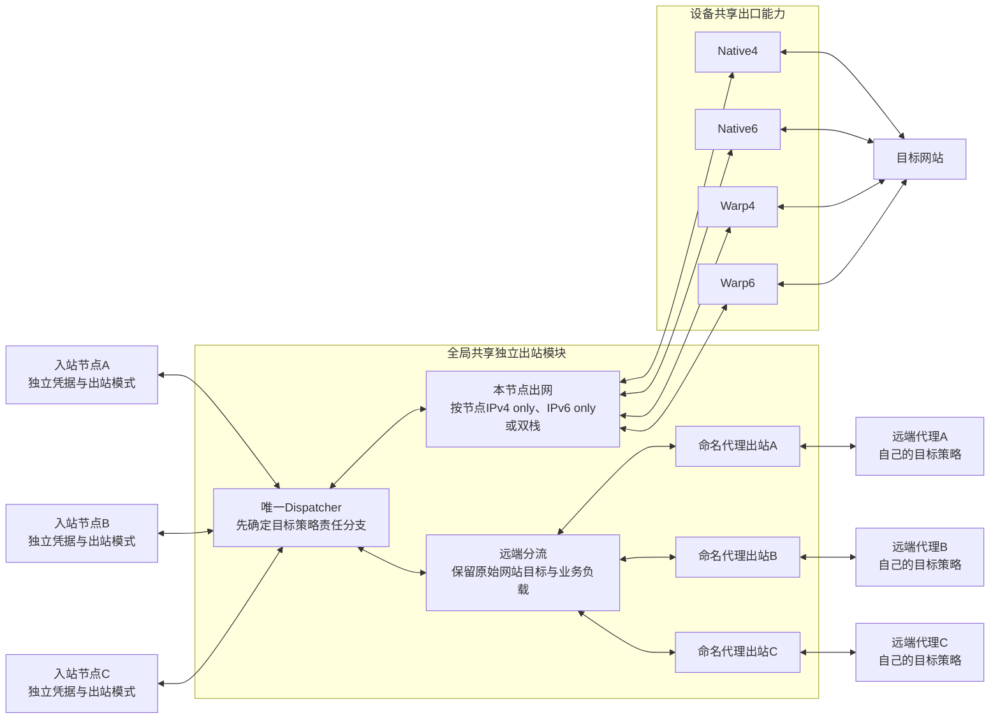

# 客户端、服务端节点与统一目标访问

状态：用户已确认双端一体、全局共享出站、节点模式、设备WARP、远端透传及多用户统计范围。当前源码仍按节点构造出站和Egress，尚未迁移；21模块发行树仍待统一验收。更新日期：2026-11-02。本文描述目标设计；实际签名及限定验证见[interfaces](interfaces/README.md)，出站依据见[0005](decisions/0005-separate-nodes-unified-egress.md)、[0006](decisions/0006-unified-client-server-core.md)、[0009](decisions/0009-global-egress-dispatcher.md)、[0010](decisions/0010-node-egress-modes-and-warp.md)，多用户与统计见[0011](decisions/0011-users-statistics-and-access-records.md)。

## 同一程序承担两个角色

| 角色 | 接入与目标访问路径 |
| --- | --- |
| 客户端 | 本机应用通过本地入口或 TUN 进入核心，统一目标访问服务选用协议出站连接远端代理 |
| 服务端 | 远端客户端连接协议节点，鉴权和解码后由统一目标访问服务选用直连或上游出口 |
| 同时启用 | 同一个程序装配多种入站、出站和访问策略，按实例与会话维护身份及资源归属 |

入站向统一服务提交业务目标；出站由该服务选择和调用，载体拨号使用底层连接器。协议出站不会把请求再无条件提交回相同的业务分发入口。各协议的入/出站能力分别验收，代码可共享，认证状态按实例独立。

## 节点与目标是两个维度

本文中的接入节点是客户端连接的服务端入口。同一个协议可以分别建立 IPv4、IPv6 节点，各自有节点 ID、接入地址和认证凭据。两者可以复用协议代码，但分别鉴权、启停和统计，认证失败不能改用另一节点的用户表或凭据。

目标是客户端请求访问的网站或服务。其地址可以是 IPv4、IPv6 或域名，与接入节点的地址族独立。IPv4 接入节点可以访问 IPv6 目标，IPv6 接入节点也可以访问 IPv4 目标；成功仍取决于实际出口的可达性和策略。

## 统一访问口

所有节点必须进入同一个共享运行调度器。调度器先确定本节点出网或远端分流，再处理业务目标。原生与WARP出口由设备级资源层统一准备，远端可以有多个独立代理配置；共享不只是接口复用。下图是目标结构，尚未完成源码迁移。

所有接入协议都向这个共享服务提交目标请求。节点可持有只绑定可信身份及共享服务引用的轻量句柄，不能持有自己的Outbound、解析器、连接池或调度表。远端分流按配置先选定一个代理，再保留原目标和业务负载转交，网站解析和地址族策略由远端负责；出站组只作为初始选择的建议，不包含远端失败后的本机替代重试。

TCP请求取得字节流，UDP请求取得保留包边界与目标语义的通道；每个连接或关联固定所选出口，回包沿相应连接或关联返回原节点。不同新连接可以分别选择代理A、B或C。只有本地路径按节点模式解析业务目标；远端路径不为多目标UDP重新选择网站IP。后续原始IP endpoint需要对应数据模型和适配，不能假冒TCP/UDP支持。

统一访问服务可以并发处理多个节点和会话，不要求单个线程、单个 socket、固定出口 IP 或一个对外监听端口。协议同端口分流属于接入层的独立能力。

共享资源由出站模块管理必要的身份分区；请求取消、节点强制取消和整个服务关闭分别处理。设备共用WARP服务不随单个节点或Engine退出关闭。不得把首个请求的取消令牌作为共享池的根生命周期，也不得在共享模块内部为每个节点嵌套完整Outbound来复制旧架构。确认范围及接口建议见[0009](decisions/0009-global-egress-dispatcher.md)及[0010](decisions/0010-node-egress-modes-and-warp.md)。

## 责任和依赖

| 所有者 | 职责 |
| --- | --- |
| 节点配置与管理 | 创建独立节点身份、接入地址和凭据引用，维护启停、配额及授权策略 |
| protocol-* 接入适配 | 处理协议握手、鉴权、传输/安全包装，输出业务目标和已认证节点上下文 |
| engine | 接纳与调度会话、固定配置代次、注入服务、管理取消和资源使用期 |
| egress | 统一确定本地/远端责任分支，本地按节点模式使用设备出口，远端保留目标转交 |
| routing / dns / net | 分别提供规则匹配、解析与缓存、底层连接和平台网络能力 |
| 具体出站模块 | 当出口采用代理协议时，负责该协议的连接与封包；不反向决定接入节点的身份 |

egress 通过接口调用这些组件，不把 DNS wire、所有协议握手或 OS 适配复制进自身。协议模块依赖 core-api 的访问契约，不依赖 egress 的具体实现；装配入口连接实现，保持无环依赖。

代理服务器的连接目标、DNS 引导目标与网站目标保留不同的用途标记。载体拨号不能重新无条件进入相同的业务路由，避免访问自身和解析依赖环。

## 节点和凭据边界

建议节点配置分别表达 `node_id`、接入地址族/地址、协议选项、认证凭据引用和目标访问策略引用。IPv4、IPv6 节点可以显式引用同一目标访问策略，但认证配置独立。配置字段名仍待实现确定，不是当前 JSON v1 可用格式。

2026-11-02多用户确认见[0011](decisions/0011-users-statistics-and-access-records.md)。一个节点允许多个独立用户，用户名默认附UUID，管理用户ID、显示名与协议凭据分开；VLESS等按实际线格式适配。节点认证成功后将可信用户归属绑定到逻辑会话和UDP关联，不能把共享物理连接当成单一用户；流量、带宽、在线信息和访问历史统一见[统计设计](statistics-and-users.md)，尚未迁移。

访问请求携带节点ID、管理用户及已认证身份引用、会话/UDP关联、原始目标、TCP/UDP模型、配置代次、预算与取消信息；不携带或记录明文口令、协议认证UUID或私钥。共享服务保留节点和用户的鉴权结果、配额及会话归属，不能只凭地址族或来源IP判断用户身份。

DNS 缓存按解析问题、解析器和策略分区决定是否共享；相同语义不必因接入地址族不同而复制。带认证身份的复用连接必须包含节点/出站实例与凭据版本等必要作用域，不能仅因目标地址相同就跨身份复用。

IPv6 节点应明确监听 IPv6，避免操作系统双栈监听无意接纳 IPv4、导致两份节点配置失去边界。这里约束接入行为，不要求整个内核分成两个业务栈。

## 目标地址选择

先确定本节点出网还是远端分流。只有本节点承担目标策略的路径应用节点IPv4 only、IPv6 only或双栈模式；双栈延续默认IPv4优先。远端分流保留原始业务目标，由远端自行决定解析和地址族，不在本机统一改写为IP。以下是目标设计，尚未实现或验证，确认依据见[0010](decisions/0010-node-egress-modes-and-warp.md)。

### 分开处理三个地址族

| 网络段 | 地址族依据 |
| --- | --- |
| 客户端到入站节点 | 对应入站的监听与客户端网络 |
| 内核到远端代理 | 代理端点地址、载体拨号策略与本机网络 |
| 最终出口到网站 | 本地分支由节点模式及设备出口决定；远端分支由远端自己的策略决定 |

原生网络和设备管理的WARP都属于本节点负责策略的逻辑出网路径。通过IPv4连接远端代理不妨碍代理访问IPv6网站，通过IPv6连接代理也不要求网站必须有IPv6。本节点的目标模式不改写代理端点，也不强制远端网站地址族；两类地址分别保留。

### 本节点的三种模式

节点模式与入站监听地址族独立。原始业务目标和已选网站IP分别保存，只有本地路径进行以下选择。

| 模式 | 域名候选与出口 |
| --- | --- |
| IPv4 only | 只选择IPv4目标及设备IPv4出口，不转为IPv6目标 |
| IPv6 only | 只选择IPv6目标及设备IPv6出口，不转为IPv4目标 |
| 双栈 | 允许IPv4与IPv6，默认IPv4优先；缺少的原生出站族由设备共享WARP补齐 |

字面IP保持原样；与本地单栈模式不兼容时明确拒绝，不隐式转换。双栈的等待上限、候选并发及建立阶段回退参数仍待设计，不能将IPv4优先误解为只查询IPv4或保证所有目标可达。网站地址选择不擅自改写客户端TLS的SNI或HTTP Host。

### 双栈缺族与设备共享WARP

建议设备资源层发布Native4、Native6、Warp4、Warp6四类逻辑能力，调度器按节点模式取用。同一设备的Warp4、Warp6共享一套WARP运行环境，不按节点复制部署。

| 原生出网能力 | 双栈使用的出口 |
| --- | --- |
| IPv4和IPv6均可用 | Native4、Native6 |
| 只有IPv4 | Native4、自动补齐的Warp6 |
| 只有IPv6 | 自动补齐的Warp4、Native6 |

WARP准备在设备部署阶段执行，不能在每次请求或配置纯校验时安装、注册或修改网络。缺族补齐成功前不能宣称双栈就绪；单次网站失败不视为设备缺族。具体WARP接入、TCP/UDP能力和生命周期仍待实现验证，单栈缺族是否也自动创建WARP尚未另行确认。

### 远端分流保持原目标

将网站域名或字面IP、端口与业务负载按所选代理协议编码转交。远端自行解析域名、选择地址族及执行后续策略，本机不为其先解析改写网站IP，不要求远端遵守本节点的IPv4优先或单栈模式。代理端点自身的域名解析与载体拨号仍由本地处理，不能与网站目标混用。

远端失败按协议返回或结束当前会话并回收本地资源，不触发本机换族、换代理、原生直连或WARP重试。部分协议返回流时尚未确认远端网站建立，例如[VLESS](interfaces/vless.md)；这不再由本机为远端尝试其他网站地址。UDP也不因收包超时重发到其他地址或代理，回包保持原关联与入站归属。

### 本地建立与数据语义

本地候选共用建立期限，单栈不跨族，双栈可在允许的建立阶段及剩余预算内切换候选。已交付业务数据不重放。固定目标UDP选定一次目标；本地多目标关联对各业务目标流保留地址选择与回包归属，不因收包超时换族重发。

### 当前实现边界

当前Egress对所有所选出站使用本机系统解析，最多32候选并将IPv4排前。TCP对返回的Io/Timeout继续候选；固定UDP选首候选；多目标UDP每次发送重新解析。它尚未按本地/远端责任分支处理目标，因此代理路径的网站域名也会被改为本地选择的IP，不符合最新透传要求。节点三种模式、设备出口注册、WARP缺族准备、共享调度器及完整本地UDP逐目标固定状态仍未实现。本次仅记录差距，不新增运行通过结论。

## 目标文件组织

| 未来位置 | 责任 |
| --- | --- |
| `crates/core-api/src/access.rs` | 目标访问请求、节点上下文和 TCP/UDP 服务契约 |
| `crates/egress/src/lib.rs`、`service.rs` | 统一访问服务与依赖注入 |
| `crates/egress/src/policy.rs`、`candidates.rs` | 访问策略及 IPv4 优先候选安排 |
| `crates/egress/src/tcp.rs`、`udp.rs` | 两类数据路径的建立、回退边界与资源回收 |
| `crates/config/src/nodes.rs` | 节点身份、接入地址及凭据/策略引用校验 |
| `crates/engine/src/nodes/` | 节点实例装配、启停和生命周期 |

此表是目标拆分布局，不是现有文件清单。当前实现集中在core-api、config、engine与egress各自的lib.rs及相关模块；例如egress/src/lib.rs已经存在，而单独的service.rs/policy.rs等布局未逐项形成。不能把文件尚未按目标拆分理解为已有服务契约未实现。

## 当前差距与验收目标

现有程序已有固定转发、协议节点/local_inbounds、真实凭据及额外秘密隔离、每节点出口实例、AccessService/Egress和系统解析下的IPv4优先候选。每节点出口装配、所有路径统一解析网站目标的行为与最新设计有差距，节点模式和设备共享WARP也待实现。公共契约与各模块按冻结快照保留结果，不代表当前21模块全部发行验收。完整规则路由、独立DNS/Fake-IP、TUN和热重载仍不在当前交付内；本次仅更新设计，没有新增构建或测试。

后续在授权worker验证独立节点鉴权、共享调度器及设备WARP唯一性；本地单栈限制、双栈缺族补齐和IPv4优先；远端原目标透传及失败不触发本机替代；节点取消、配额及TCP/UDP回包不串用；已交付业务数据不重放。当前未增加这些验证的通过结果。
