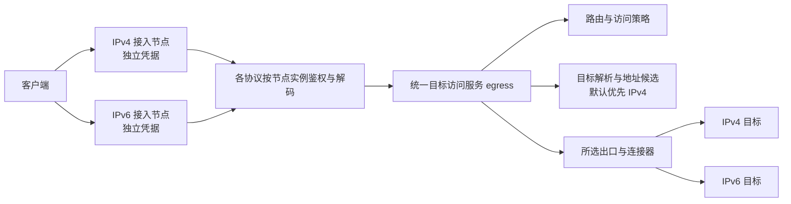

# 客户端、服务端节点与统一目标访问

状态：用户已确认双端一体及节点/目标职责边界；基础节点与统一出口已实现；最新生命周期增量仍待复验。日期：2026-10-30。确认依据见 [0005](decisions/0005-separate-nodes-unified-egress.md)、[0006](decisions/0006-unified-client-server-core.md)，实际接口与开发状态见 [interfaces](interfaces/README.md)。

## 同一程序承担两个角色

| 角色 | 接入与目标访问路径 |
| --- | --- |
| 客户端 | 本机应用通过本地入口或 TUN 进入核心，统一目标访问服务选用协议出站连接远端代理 |
| 服务端 | 远端客户端连接协议节点，鉴权和解码后由统一目标访问服务选用直连或上游出口 |
| 同时启用 | 同一个程序装配多种入站、出站和访问策略，按实例与会话维护身份及资源归属 |

入站向统一服务提交业务目标；出站由该服务选择和调用，载体拨号使用底层连接器。协议出站不会把请求再无条件提交回相同的业务分发入口。各协议的入/出站能力分别验收，代码可共享，认证状态按实例独立。

## 节点与目标是两个维度

本文中的接入节点是客户端连接的服务端入口。同一个协议可以分别建立 IPv4、IPv6 节点，各自有节点 ID、接入地址和认证凭据。两者可以复用协议代码，但分别鉴权、启停和统计，认证失败不能改用另一节点的用户表或凭据。

目标是客户端请求访问的网站或服务。其地址可以是 IPv4、IPv6 或域名，与接入节点的地址族独立。IPv4 接入节点可以访问 IPv6 目标，IPv6 接入节点也可以访问 IPv4 目标；成功仍取决于实际出口的可达性和策略。

## 统一访问口

所有接入协议都调用同一套内部服务。TCP 请求取得字节流，UDP 请求取得保留包边界与目标语义的通道；统一接口不将两者压成同一种 I/O。后续原始 IP endpoint 需要对应数据模型和适配，不能假冒 TCP/UDP 支持。

统一访问服务可以并发处理多个节点和会话，不要求单个线程、单个 socket、固定出口 IP 或一个对外监听端口。协议同端口分流属于接入层的独立能力。

## 责任和依赖

| 所有者 | 职责 |
| --- | --- |
| 节点配置与管理 | 创建独立节点身份、接入地址和凭据引用，维护启停、配额及授权策略 |
| protocol-* 接入适配 | 处理协议握手、鉴权、传输/安全包装，输出业务目标和已认证节点上下文 |
| engine | 接纳与调度会话、固定配置代次、注入服务、管理取消和资源使用期 |
| egress | 统一处理目标访问请求，协调访问权限、路由、解析候选、出口建立和受限回退 |
| routing / dns / net | 分别提供规则匹配、解析与缓存、底层连接和平台网络能力 |
| 具体出站模块 | 当出口采用代理协议时，负责该协议的连接与封包；不反向决定接入节点的身份 |

egress 通过接口调用这些组件，不把 DNS wire、所有协议握手或 OS 适配复制进自身。协议模块依赖 core-api 的访问契约，不依赖 egress 的具体实现；装配入口连接实现，保持无环依赖。

代理服务器的连接目标、DNS 引导目标与网站目标保留不同的用途标记。载体拨号不能重新无条件进入相同的业务路由，避免访问自身和解析依赖环。

## 节点和凭据边界

建议节点配置分别表达 `node_id`、接入地址族/地址、协议选项、认证凭据引用和目标访问策略引用。IPv4、IPv6 节点可以显式引用同一目标访问策略，但认证配置独立。配置字段名仍待实现确定，不是当前 JSON v1 可用格式。

访问请求携带节点 ID、已认证身份引用、会话/UDP 关联、原始目标、TCP/UDP 数据模型、配置代次、预算与取消信息；不携带或记录明文口令、UUID 或私钥。共享服务按节点保留鉴权结果、配额和会话归属，不能只凭地址族判断用户身份。

DNS 缓存按解析问题、解析器和策略分区决定是否共享；相同语义不必因接入地址族不同而复制。带认证身份的复用连接必须包含节点/出站实例与凭据版本等必要作用域，不能仅因目标地址相同就跨身份复用。

IPv6 节点应明确监听 IPv6，避免操作系统双栈监听无意接纳 IPv4、导致两份节点配置失去边界。这里约束接入行为，不要求整个内核分成两个业务栈。

## 目标地址选择

默认策略为 IPv4 优先，以下为实现建议：

| 目标或结果 | 行为 |
| --- | --- |
| IPv4 字面量 | 直接使用该 IPv4 地址，不合成 IPv6 替代地址 |
| IPv6 字面量 | 直接使用该 IPv6 地址，不尝试将其转换成 IPv4 |
| 域名同时有 A、AAAA 候选 | 排列可用 IPv4 候选在前，再按剩余建立预算尝试 IPv6 |
| 域名仅有 IPv6 候选 | 在出口支持 IPv6 时使用该候选 |
| 建立失败 | 仅在允许的失败阶段、次数和预算内尝试下一候选；记录实际选用的地址族 |

“优先 IPv4”是目标候选与连接安排，不等于关闭 AAAA 查询或始终禁止 IPv6。候选是否并行解析、IPv4 等待上限和各类失败是否允许回退，属于后续接口的明确参数。

TCP 已发送业务数据后不能换地址重放。UDP 目标流建立后保持目标与回写语义稳定，不能因为响应较慢就将相同数据报再发到另一地址族。入站认证失败也不属于目标回退理由。

若某种出口把域名交给另一代理解析，要显式表达该模式能否保证 IPv4 优先；只有域名而无法控制远端解析策略时，不能声称本模块已经保证最终地址选择。

## 目标文件组织

| 未来位置 | 责任 |
| --- | --- |
| `crates/core-api/src/access.rs` | 目标访问请求、节点上下文和 TCP/UDP 服务契约 |
| `crates/egress/src/lib.rs`、`service.rs` | 统一访问服务与依赖注入 |
| `crates/egress/src/policy.rs`、`candidates.rs` | 访问策略及 IPv4 优先候选安排 |
| `crates/egress/src/tcp.rs`、`udp.rs` | 两类数据路径的建立、回退边界与资源回收 |
| `crates/config/src/nodes.rs` | 节点身份、接入地址及凭据/策略引用校验 |
| `crates/engine/src/nodes/` | 节点实例装配、启停和生命周期 |

这些路径尚未创建。现有 `Outbound` 可作为所选出口的基础契约继续演进；不能仅给它改名，就登记为已经实现新的接入节点与统一访问职责。

## 当前差距与验收目标

现有程序提供回环固定转发入口和 VLESS 客户端出站。它没有本设计的服务端节点管理、独立节点凭据、统一目标访问模块、完整访问策略或明确的 IPv4 优先候选安排。本轮澄清并保存双端设计，未改写这些实现，也未新增构建或测试。

后续在授权 worker 验证：IPv4/IPv6 节点各自接受正确凭据并拒绝另一节点凭据；不同协议调用同一访问服务；两类接入均可访问两类目标；域名选择遵守 IPv4 优先与回退预算；节点取消、配额和 UDP 回包不串用；已有业务数据不会跨候选重放。
