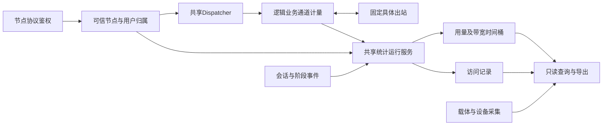

# 多用户、用量统计与访问记录

状态：需求范围已确认，以下数据模型、计量位置和保存方式是适配建议，尚未实现或验证。日期：2026-11-02。用户要求单节点多用户、独立用户名和密码、用户名默认UUID后缀，并保存用户流量、带宽和域名/IP访问记录。确认依据见[0011](decisions/0011-users-statistics-and-access-records.md)。

本文在[共享调度器](decisions/0009-global-egress-dispatcher.md)与[节点模式及远端透传](decisions/0010-node-egress-modes-and-warp.md)上增加身份和计量责任，不改变其出站所有权。实际接口仍见[interfaces](interfaces/README.md)；不能把本设计中的字段直接加入当前JSON v1。

## 确认范围与Xray适配

本次“Xray有的也要有”指已经核对的日志、流量统计、在线信息和查询导出能力。固定来源和差异见[Xray研究](../reference/research_notes/xray-statistics-and-access.md)，不是对Xray全部产品功能的兼容承诺。

| 能力 | kerlico目标 |
| --- | --- |
| 多用户与识别 | 单节点多个独立用户，用户名默认附UUID；稳定管理用户ID与协议认证材料分开 |
| 用户流量 | 按用户累计上传、下载字节，支持按节点和时间范围查看 |
| 入站、出站流量 | 按节点和具体命名出站归集业务量，另列载体量，适配共享Dispatcher |
| 带宽 | 上传、下载各自的当前窗口速率、区间平均、采样窗口峰值及历史序列 |
| 在线信息 | 在线用户、按用户来源IP列表和数量，逻辑会话与物理连接分别计数 |
| 访问日志 | 用户、节点、原目标域名或IP、端口、网络类型、所选出口和可观察状态，补充结束与用量 |
| DNS与错误日志 | 可选DNS查询记录、分类错误及级别过滤，不将解析候选当成实际网站连接 |
| 输出控制 | 文件与控制台输出、开关、地址遮罩；持久访问记录另有字段和保留策略 |
| 查询与导出 | 按用户、节点、出站查询当前量及历史，过滤和分页访问记录，导出运行指标 |
| 保存与恢复 | 持久化用量、速率时间桶和访问记录，重启恢复已提交数据，明确未提交窗口 |
| 运行资源 | 运行时长、受管理任务、平台可提供的进程内存和采集健康状态，不复制Go专用指标 |

这些都是交付目标，没有新增通过结果。带宽统计是对实际用量采样，不自动包含带宽限速、流量配额或计费策略。

## 账户、节点和协议凭据

建议管理域内用户具有不可变`UserId`，用户名默认按`名称_UUID`生成并校验唯一性。UUID后缀不是唯一约束的替代。改名、重置密码、轮换协议凭据不创建新的统计身份，也不清空历史。

用户记录保存用户名和密码管理信息，节点成员关系保存`NodeId`、`UserId`、状态与协议凭据引用。一个用户是否可加入多个节点、是否合并额度仍是产品待决项；模型保留成员关系，不能从同名、相同来源IP或相同口令自动合并用户。

统一账户适配协议实际认证格式。SOCKS5、HTTP等使用协议允许的用户名和密码；VLESS使用认证UUID，Trojan、AnyTLS使用口令。管理用户UUID不是VLESS认证UUID，不能直接复用并在日志公开认证材料。密码校验材料和协议所需秘密由认证模块管理，不要求所有协议使用同一种密码存储表示。

IPv4、IPv6及其他独立节点仍保留各自凭据域。显式关联同一个管理用户不允许隐式复用跨节点认证材料，也不放宽既有凭据查重规则。协议不支持区分用户时不能声明具有逐用户统计；需要先完成适配或明确拒绝该配置。

鉴权成功后签发可信的用户会话归属，至少包含管理域、Engine运行标识、节点、用户、逻辑会话或UDP关联、配置与凭据版本。入站网络输入不能直接指定这些可信标识。鉴权失败记录未认证状态，不把客户端声称的用户名计入某个已认证用户。

本地无认证入口使用独立的本地来源类别，用户字段可为空，不能伪造普通用户。后台任务、DNS引导和探测也有独立来源，不混入用户业务量。

## 责任与数据流

每个Engine装配一个共享统计运行服务，所有节点和共享Dispatcher向它提交可信归属及计量结果。统计实现独立于协议和出站工厂，节点不各自维护另一份历史数据库。

协议适配器识别用户并报告阶段事实。共享服务统一分配统计归属、绑定实际出站、维护逻辑业务计量及会话结束。DNS、net和设备层只报告自己能观察到的信息，不能从一个来源IP猜测用户。

共享载体的握手、复用控制和连接开销归载体统计。各逻辑会话保留自己的用户归属，不因复用而将整条物理连接算给第一个用户。设备网卡和WARP由设备所有者采集一次，多Engine导出时按设备来源标识去重，不各自相加成设备总量。

## 流量口径与唯一计量位置

上传统一表示用户向目标发送业务载荷，下载表示目标向用户返回业务载荷。设备RX、TX另行命名，不能把代理服务器两条网络腿的收发相加后记为用户用量。

建议以共享访问服务返回的逻辑业务通道为唯一计量边界。上传在业务通道确认接纳字节时计量，下载在该通道向入站交付字节时计量。这表示本地API确认的交接，不证明目标应用或客户端最终收到。

| 数据路径 | 建议计数规则 |
| --- | --- |
| TCP | 按成功操作报告的实际字节增加，部分写只计已确认部分，读零字节不增加流量 |
| 固定UDP | 整包提交成功后增加载荷字节和包数，接收通过通道校验并交付后计下载 |
| 多目标UDP | 每包保留目标和来源，按原用户及固定关联出口计量，不重新选择代理 |
| 空UDP包 | 字节增量为零，包数增加，不能当作关闭 |
| 排队、拒绝、丢弃和失败 | 不将待发送长度计为成功交接量，单独记录丢弃或错误事件 |
| 预读、首包及特殊转发 | 必须经过同一计量边界，或向同一账本提交可去重的等价计量，不额外再计一次 |

取消或协议部分发送失败按原通道语义处理，不为补计量重放数据。未由API确认的发送量不估算成已交接量；载体实际开销可以与业务计量不同。

一次确认的业务增量分别投影到用户、节点、具体出站和Engine总量。用户经节点A、代理B上传100MB时，各视图显示同一100MB，Engine业务总量仍为100MB。不能把各维度相加，也不能在入站和出站包装器各记一次后相加。

出站初始选择组只记录实际使用的成员，不给组成员轮流加量。连接和UDP关联保持所选出站。节点接入族、代理载体族、本地网站目标族分别统计；远端网站地址族未知时保留未知，不能用节点模式或代理端点族替代。

业务字节、载体字节和设备网卡字节有不同测量层标识，分别展示。握手、TLS、协议封装、WARP和重传开销不直接摊成某个用户的业务用量。

## 带宽采样与历史

带宽取自同一层的累计字节差值。速率以`8 × 字节增量 ÷ 实际经过秒数`得到bit/s，也可显示byte/s，但字段和单位必须明确。

当前速率表示最近一个有效采样窗口。区间平均用该区间累计字节除以有效经过时间。峰值是该区间采样窗口速率的最大值，不宣称捕获每个瞬间的峰值。上传、下载分别保存，合计峰值由同一时间窗口计算，不能把不同时刻的两个峰值相加。

同一运行期用单调时钟计算经过时间，墙上时间用于历史定位。每条时间桶保留起止时间、实际时长、字节增量、采样版本和质量状态。没有两个有效样本时速率未知；确认无流量的有效窗口为零；重启、暂停采集和数据缺口不能显示成正常零速率。

用户、节点、实际出站及Engine总量可分别查看实时和历史。历史聚合保留字节合计、覆盖时长和原采样峰值，不能简单平均不同长度窗口的速率，也不能把更粗时间桶平均值当原始峰值。

采样间隔、历史桶粒度、保留期限和查询时区由配置明确，不在本文发明未经确认的固定数值。启动或采样配置改变时标明代次，跨重启的累计历史不拿来直接相减生成一次异常带宽尖峰。

## 在线用户、连接和来源IP

物理载体、活跃逻辑会话、UDP关联和关联内目标流分别维护创建与结束，不能由旧`accepted - completed - failed`推算活跃连接。握手失败、建立失败、正常结束与应用访问成功也分别处理。

用户在线表示至少存在一个归属明确且未结束的已认证逻辑会话或UDP关联。来源IP表按该范围引用计数，最后一个会话结束时移除该IP的在线引用。来源IP数量不是设备数量，同一NAT后的多个设备无法据此区分。

在线IP可提供首次出现、最近建立与连接数。若显示最近业务活动，必须由实际业务活动更新，不把最近建立时间换个名字当成最近活动。超时和取消后释放一次引用，不因单个共享载体关闭而重复减计其他用户。

## 访问、DNS和错误记录

用量汇总与访问记录分别保存，通过稳定标识关联，不靠解析日志文本或用户名拼接找回身份。建议访问记录采用以下字段组。

| 字段组 | 内容及可观察边界 |
| --- | --- |
| 归属 | 管理域、Engine运行、节点、用户、逻辑会话、UDP关联或目标流、配置代次 |
| 时间 | 接纳、鉴权、目标建立阶段、结束时间，持续时长及尚在进行状态 |
| 来源 | 实际观察到的客户端地址和端口，附来源类型；未认证记录不冒充已认证用户 |
| 原目标 | 原请求域名或IP、端口、TCP或UDP；不被路由、嗅探或DNS覆盖 |
| 目标补充 | 可选观察域名及来源、解析候选、本机确知的业务连接IP，三者分开 |
| 出站 | 固定命名出站、本地或远端分支、本地Native/WARP能力；代理端点IP另列 |
| 用量 | 该会话累计上传、下载字节及UDP包数，注明测量层和计量质量 |
| 状态 | 已接纳、已认证、本地建立就绪、远端确认若协议提供、结束原因及错误阶段 |

远端代理自行解析网站时，业务连接IP与地址族可为空。不能把代理端点IP写成网站IP，也不为补日志在本机提前解析远端网站目标。`accepted`和返回业务通道不等于网站访问成功，缺少远端确认的协议不能生成虚假的网站成功记录。

多目标UDP关联按目标活动聚合访问记录，不把每个包都当新用户会话；不能声称观察到了UDP网站连接成功或确定的服务端结束时刻。未联系来源和回包来源沿用协议原有能力与过滤语义。

可选DNS记录包含解析目的、解析器、查询域名和类型、候选结果、缓存状态、耗时与错误。只有有可信调用上下文时才关联用户；共享缓存命中或引导查询不能凭域名归给某用户。解析候选不是本次实际使用的业务连接IP。

错误日志支持分类、级别和受控原因。访问日志、DNS日志与错误日志各有输出开关；提供文件、控制台和地址遮罩能力。数据存储的停用、字段脱敏、保留和清理策略另行明确，控制台不输出不等于停止采集或删除历史。用户名、管理UUID与协议凭据分开，明文密码、认证UUID、密钥、令牌和载荷不进入统计或日志。

## 持久化、查询与故障

建议统计服务使用有界的会话累计量和周期批次，持久保存用户、节点、出站及时间范围的用量，以及独立的速率桶、访问记录。不能为每个包同步写数据库，也不能用无限队列假装没有丢失风险。正常关闭先停止新会话，再收齐结束与最后增量，最后提交并关闭存储。

计量批次带运行标识、会话、方向、测量层和单调序号或累计水位。重送、恢复和最后结算按已提交水位去重。访问结束记录中的累计量用于展示和核对，不能再作为新增用量累加一次；取消与错误只结束同一会话一次。

重启恢复已提交历史，新的运行标识避免复用会话键。未提交窗口在崩溃或存储故障时可能损失，必须报告水位、滞后和已知缺口，不能承诺未设计的零丢失或精确计费。后台任务不继承某个节点或用户的取消根，关闭单用户不能关闭共享统计或存储。

默认按观测用途设计有界异步保存，存储滞后或不可用时保持转发并报告采集降级；尚未确认强制额度或计费模式，不能在历史有缺口时宣传为可精确结算。严格持久化、存储失败是否拒绝新业务及其权限行为，须在相关产品范围确认后单独定义。

查询支持用户、节点、实际出站及时间范围，返回测量层、单位、运行代次和数据水位。访问记录过滤与分页，在线信息单独查询，指标导出只读。若提供读取并清零兼容能力，只重置调用方的查询基线或观测窗口，不删除持久历史或其他调用方的基线。

域名、目标IP和会话ID进入可控的访问记录与索引，不成为无限增长的高频指标标签。逐用户明细通过有范围的查询取得；指标导出限制标签集合，不能为用户与所有目标的组合无限创建时间序列。

统计与日志策略必须区分启用、保存和导出。保存需明确运行数据目录、容量上限、访问权限、脱敏及清理方式，不进入源码仓库。实际存储后端、查询协议和配置字段尚未选定，不宣称兼容Xray JSON或gRPC。

## 仍需细化与验证

单节点多用户、独立账户、逐用户流量及带宽、域名/IP访问记录和已核对Xray统计能力已确认。跨节点用户授权、限速/额度/计费、到期与禁用时对已有会话的处理，仍没有具体策略。存储后端、采样参数、保留期限及部署默认值属于后续实现设计。

当前仅部分协议具备多UUID或多口令配置；`ConnectContext`只有取消与超时，`NodeObserver`与Engine `Stats`只有四类累计事件。没有统一管理用户身份、上述业务计量、历史带宽或访问存储。这一差距不能由旧多节点测试结果消除。

后续在授权worker验证多用户鉴权及伪造身份拒绝、改名/凭据轮换保持归属、共享出站复用不串账、TCP部分写、UDP零包和丢弃、预读不双计、多目标关联、各维度总量、采样时间与峰值、在线引用回收、会话结束去重、重启和重复上报、存储失败降级、清零不删历史，以及远端未知IP不触发本地解析。当前没有这些验证的通过结果。
