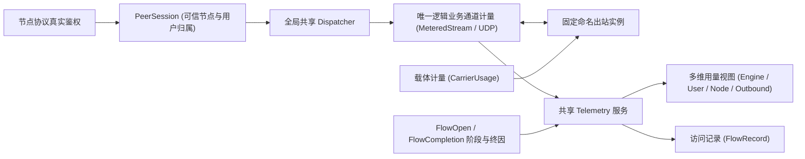

# 多用户、用量统计与访问记录

更新日期：2026-11-02（Asia/Shanghai）

本文定义单节点多用户管理、唯一业务流量计量、带宽采样、在线来源追踪以及访问/DNS/错误记录与持久化查询的目标架构（决策依据见 [0011](decisions/0011-users-statistics-and-access-records.md)，上游对照见 [Xray 统计与访问记录研究](../reference/research_notes/xray-statistics-and-access.md)）。

## 功能范围概览

| 领域 | 设计目标 | 当前源码状态 |
| --- | --- | --- |
| 多用户与凭据分离 | 单节点支持多个独立用户，用户名默认附 UUID 后缀；持久管理 `UserId` 与各协议原生凭据（`native_credential`）映射分离 | **已实现**（见 `kerlico-config` 与 `account-new` 命令） |
| 唯一业务流量计量 | 在共享 `Dispatcher` 逻辑业务通道唯一计量上传/下载字节，一次增量同时投影至用户、节点、命名出站与 `Engine` 视图 | **已实现**（见 `crates/egress/src/meter.rs` 与 `telemetry.rs`） |
| 载体字节统计 | 按命名出站或节点独立累计底层载体确认收发字节（`CarrierUsage`），与用户业务流量分开展示 | **已实现接口**（`record_carrier` / `carrier_usage`，WireGuard 已接入） |
| 内存态访问记录 | 记录会话归属、起止时间、观测来源、原始目标、实际绑定端点、所选出站、阶段状态、终因与累计流量 | **已实现**（`Engine::telemetry().records()`，有界内存保留） |
| 带宽采样与历史序列 | 上传/下载当前窗口速率、区间平均、采样峰值及按时间桶保存的历史序列 | **已实现**（SQLite `bandwidth`） |
| 在线用户与来源 IP 视图 | 活跃逻辑会话/UDP 关联引用计数、在线用户列表及每用户来源 IP 统计 | **已实现 Rust 接口**（`Telemetry::online()`），CLI 未暴露 |
| 持久化存储与查询导出 | 用量、带宽时间桶与访问记录落盘（如 SQLite）、重启水位恢复、日志脱敏/保留控制及只读查询导出 | **已实现**（`kerlico history`），含 DNS 与错误事件 |

## 账户、节点与协议凭据

1. **管理账户（`AccountSpec`）**：
   - 拥有不可变的管理 `UserId`（非零 UUID）、唯一用户名（默认格式 `<prefix>_<uuid>`）与 Argon2id PHC 密码摘要（`password_hash`）。
   - 修改用户名、重置管理密码或轮换节点协议凭据（`credential_epoch`）不会生成新的 `UserId`，从而保持统计身份连续。
2. **协议原生凭据（`native_credential`）**：
   - 节点通过 `members` 列表显式绑定 `user_id` 与该协议的原生认证材料（如 VLESS/VMess 的 UUID、Trojan/AnyTLS/Shadowsocks 的密码、SOCKS/HTTP/Naive 的用户名密码、WireGuard 的 peer 公钥与 AllowedIPs）。
   - 管理密码摘要不直接充当协议线格式密码；IPv4 与 IPv6 节点分别声明各自的 `members` 与独立协议秘密，跨节点秘密复用在配置编译期被 `CredentialManifest` 拒绝。
3. **鉴权后可信归属**：
   - 入站协议完成真实线格式鉴别后，通过 `IngressBinding::authenticated` 签发绑定 `NodeId`、`UserId`、`credential_epoch` 与客户端观测地址的 `PeerSession`。
   - 显式本地无认证入口通过 `IngressBinding::local` 签发 `Source::Local`，不伪造管理用户。鉴权失败的尝试不归入客户端自报的用户名。

## 计量架构与数据流

### 流量口径与唯一计量位置

- **方向定义**：上传（Upload）固定表示入站客户端向目标发送的业务载荷字节；下载（Download）固定表示目标向入站客户端返回的业务载荷字节。
- **唯一计量边界**：在 `Dispatcher` 返回给入站的逻辑业务通道（`TcpFlow`、`FixedUdpFlow`、`UdpAssociation`）处封装一次计量：
  - **TCP**：按 `AsyncWrite` 成功写入字节与 `AsyncRead` 成功读取交付字节累加；`Pending`、错误、`EOF`、`flush` 与 `shutdown` 不增加字节。
  - **UDP**：按成功发送或交付的完整数据报载荷字节与包数累加；零字节空包增加包数（`packets + 1`），字节增量为 0。
  - **多维投影**：同一次确认的业务字节增量同时投射至 `Engine` 总量、`UserId`、`NodeId` 与 `OutId` 四个维度视图，各视图之间不重复相加。
  - **载体开销分离**：TLS/QUIC 握手、多路复用控制帧、WireGuard 封装头与重传不计入用户业务流量，另通过 `CarrierUsage` 或设备层指标单独统计。

## 访问记录字段（`FlowRecord`）

每条逻辑流或 UDP 关联由唯一的 `FlowId` 与 `FlowLease` 追踪，记录以下结构化元数据（不包含明文密码、协议认证 UUID、私钥或业务载荷）：

| 字段类别 | 记录内容与边界 |
| --- | --- |
| 归属标识 | `FlowId`、管理 `UserId`（或 `Local`）、`NodeId`、命名出站 `OutId`、配置与凭据代次、`FlowKind`（TCP / FixedUdp / UdpAssociation） |
| 时间与阶段 | 创建时间、进入活跃转发时间、结束时间，以及当前阶段（`Opening` / `Active` / `Closed`） |
| 来源与目标 | 客户端实际观测地址（`peer_addr`）、入站原始请求目标（`OriginalTarget`）、嗅探/观测目标（若有） |
| 实际目标绑定 | `TargetBind::Known`（本地直连 Socket 绑定或 SOCKS `BND` 报告）或 `TargetBind::Unknown`（远端代理自行解析时保留未知，不触发额外本地 DNS） |
| 多目标 UDP 明细 | 关联内访问的各目标记录（`DatagramTargetRecord`，含首次/最后活动时间、收发字节与包数） |
| 用量与终因 | 该流累计上传/下载字节与包数，以及首次确定的结束原因（`DuplexEof` / `ProtocolEnd` / `Cancelled` / `Timeout` / `Failed` 等） |

## 持久化与带宽采样设计

1. **带宽采样与时间桶**：
   - 基于单调时钟窗口计算实时上传/下载速率（`bit/s` 或 `byte/s`）、区间平均速率与采样窗口峰值；区分无流量零值与重启/未采样缺口。
2. **持久化存储与水位恢复**：
   - 将累计用量、带宽时间桶与访问记录异步批量提交至持久化后端（如 SQLite），附带运行标识与单调水位防止崩溃恢复后重复累加。
   - 正常关闭时在排空会话后提交最终水位；查询重置仅更新调用方观测基线，不删除持久化历史数据。
3. **日志输出与隐私控制**：
   - 提供访问日志、可选 DNS 日志与分类错误日志的独立开关、控制台/文件输出、客户端 IP 遮罩与保留期限清理策略。
